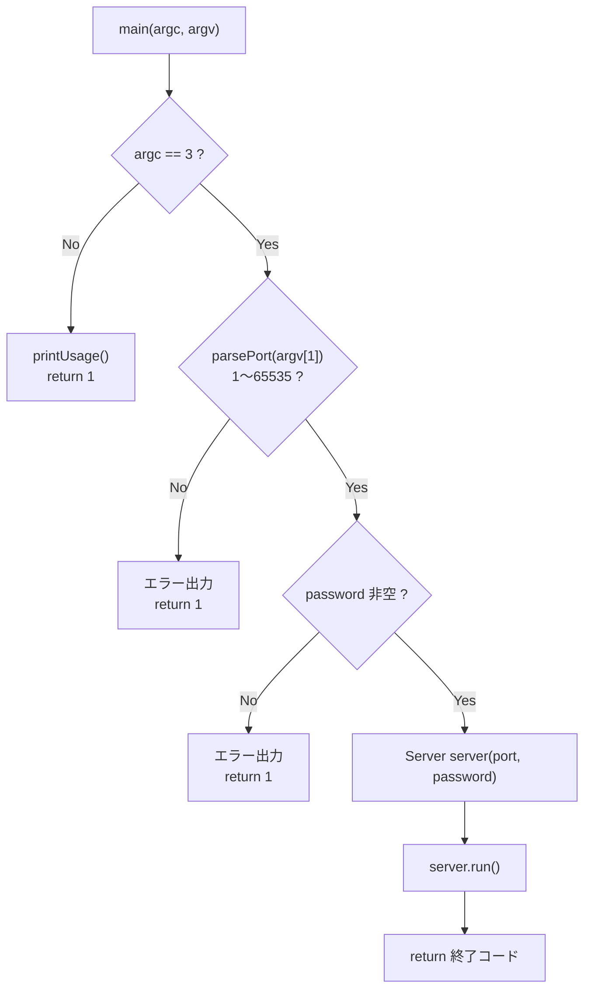
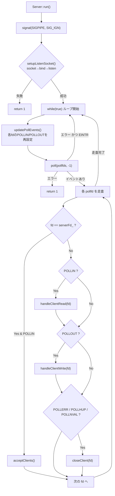
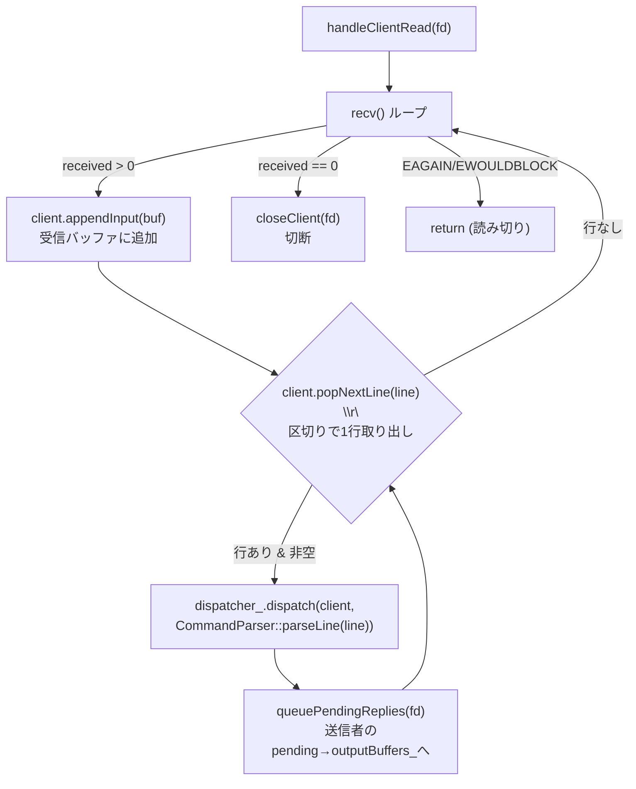
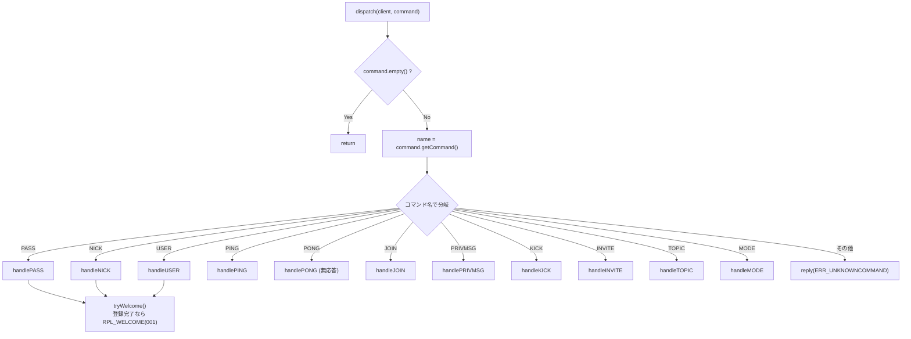

# ft_irc 関数フロー (main からの流れ)

`main()` を起点に、起動 → イベントループ → コマンド処理 → 応答送信までの
関数呼び出しの流れを Mermaid で図示する。

---

## 1. 起動フロー: `main()` → `Server::run()`



---

## 2. イベントループ: `Server::run()`



`acceptClients()` は新規接続を `accept()` し、ノンブロッキング化して
`clients_` / `pollfds_` / `outputBuffers_` に登録する。

---

## 3. 受信 → 解析 → ディスパッチ: `handleClientRead()`



`CommandParser::parseLine()` は1行を `ParsedCommand`
(コマンド名 + パラメータ列) に分解する。

---

## 4. コマンドディスパッチ: `CommandDispatcher::dispatch()`



各ハンドラは3つの協力オブジェクトを使う:

| 依存 | 役割 |
|------|------|
| `replyBuilder_` | 応答文字列を組み立てる (`reply` / `numeric` / `channelMessage` / `pong`) |
| `channelManager_` | チャンネル状態の参照・更新 (join/kick/mode/topic/membership) |
| `server_` | 他クライアントへの配信 (`broadcastToChannel` / `sendToNick` / `changeNickname`) |

---

## 5. ハンドラ内部の典型フロー (例: `handleJOIN` / `handlePRIVMSG`)

```mermaid
flowchart TD
    subgraph JOIN["handleJOIN"]
        J1{"params 空 ?"} -->|Yes| JE["reply(ERR_NEEDMOREPARAMS)"]
        J1 -->|No| J2["招待制/鍵/満員チェック<br/>(channelManager_)"]
        J2 -->|拒否| JE2["reply(ERR_*)"]
        J2 -->|許可| J3["channelManager_.join()"]
        J3 --> J4["server_->broadcastToChannel(<br/>JOIN メッセージ)"]
        J4 --> J5["RPL_TOPIC / RPL_NAMREPLY を本人へ"]
    end

    subgraph PRIVMSG["handlePRIVMSG"]
        P1{"params < 2 ?"} -->|Yes| PE["reply(ERR_NEEDMOREPARAMS)"]
        P1 -->|No| P2{"宛先が #channel ?"}
        P2 -->|Yes| P3["channelManager_.sendToChannel()<br/>=メンバー確認"]
        P3 -->|非メンバー| PE2["reply(ERR_CANNOTSENDTOCHAN)"]
        P3 -->|OK| P4["server_->broadcastToChannel(<br/>本人を除外)"]
        P2 -->|No (nick宛)| P5["server_->sendToNick()"]
        P5 -->|不在| PE3["reply(ERR_NOSUCHNICK)"]
    end
```

---

## 6. 配信が相手に届くまで (POLLOUT による flush)

他クライアント宛の応答は、ハンドラ内で相手の `ClientSession` の
送信キューに積まれるだけ。実際の `send()` は次のループで POLLOUT が
立ってから行われる。

```mermaid
sequenceDiagram
    participant A as Alice (送信者)
    participant Loop as run() ループ
    participant Disp as CommandDispatcher
    participant Srv as Server
    participant B as Bob (受信者 ClientSession)

    A->>Loop: PRIVMSG #room :hi
    Loop->>Disp: handleClientRead → dispatch
    Disp->>Srv: broadcastToChannel(#room, msg, exc= Alice)
    Srv->>B: sendToClient → B.enqueueReply(msg)
    Note over B: Bob の送信キューに積まれる
    Loop->>Loop: 次周回 updatePollEvents()<br/>Bob.hasPendingOutput()→ POLLOUT 付与
    Loop->>Srv: handleClientWrite(Bob.fd)
    Srv->>B: queuePendingReplies → send()
    B-->>A: (Bob のクライアントが受信)
```

---

## まとめ (呼び出し階層)

```
main()
└─ Server::run()
   ├─ setupListenSocket()        // socket / bind / listen
   └─ while(true)
      ├─ updatePollEvents()      // POLLIN/POLLOUT 再計算
      ├─ poll()
      ├─ acceptClients()         // 新規接続
      ├─ handleClientRead(fd)
      │  ├─ ClientSession::appendInput / popNextLine
      │  ├─ CommandParser::parseLine()
      │  ├─ CommandDispatcher::dispatch()
      │  │  └─ handlePASS/NICK/USER/PING/JOIN/PRIVMSG/KICK/INVITE/TOPIC/MODE
      │  │     ├─ ReplyBuilder::reply / pong / channelMessage
      │  │     ├─ ChannelManager::join / kick / setMode / ...
      │  │     └─ Server::broadcastToChannel / sendToNick / changeNickname
      │  └─ queuePendingReplies(fd)
      ├─ handleClientWrite(fd)    // send() で実送信
      └─ closeClient(fd)          // 切断時
```
