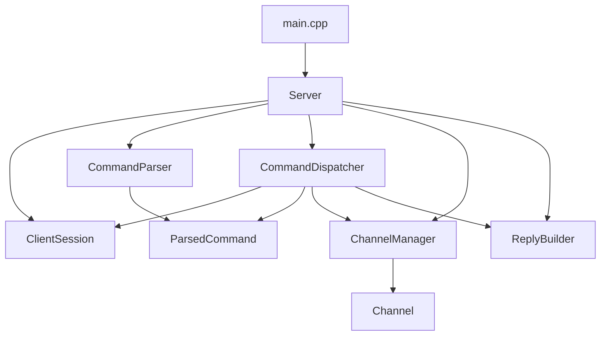

# ft_irc Module Dependency Graph

This graph is the contract-first skeleton for three-person parallel work.
The goal is to keep `main` buildable while each member replaces stubs with
real implementation.

## Compile-time Graph

## Ownership Boundaries

- **Member A owns** `Server` and `ClientSession` transport fields:
  socket lifecycle, `poll()`, fd state, input buffer, output queue.
- **Member B owns** `CommandParser`, `ParsedCommand`,
  `CommandDispatcher`, and `ReplyBuilder`: IRC syntax, command flow,
  numeric replies.
- **Member C owns** `Channel` and `ChannelManager`: membership, operator
  state, channel modes, permission checks, and test scenarios. These APIs
  accept nicknames as strings, so domain work does not depend on the
  transport/client module.

## Dependency Order

1. Keep public headers stable first.
2. Use `Server::dispatchLineForTest()` when network code is not ready.
3. Use `ChannelManager` stubs while command handlers are being built.
4. Use `CommandDispatcher` stubs while the event loop is being built.
5. Replace one stub at a time and keep `make re` passing on `main`.

## Current Stub Scope

- `Server::run()` does not listen yet; it is the placeholder for Member A's
  non-blocking socket and `poll()` implementation.
- `ClientSession` stores parsed state and whole queued replies; Member A must
  add fd lifecycle and partial send/recv behavior.
- `CommandDispatcher` handles only enough command flow to exercise boundaries;
  Member B must replace it with full IRC command semantics.
- `CommandParser` is a minimal line parser; Member B must harden edge cases.
- `ChannelManager` and `Channel` preserve minimal membership/operator state;
  Member C must add real modes, invites, keys, limits, and permission rules.
- `ReplyBuilder` contains early numeric helpers; Member B must make it the
  single source of reply formatting.

## Integration Rules

- `Server` may know every module because it is the integration layer.
- `Channel` must not know sockets, fds, `poll()`, or raw IRC lines.
- `ChannelManager` must not depend on `ClientSession`; command code passes
  nicknames into the domain layer.
- `CommandParser` must not mutate client or channel state.
- `CommandDispatcher` may coordinate client/channel updates, but it should
  call public APIs instead of editing model internals.
- `ClientSession::enqueueReply()` is the only stubbed output boundary for
  protocol code.
