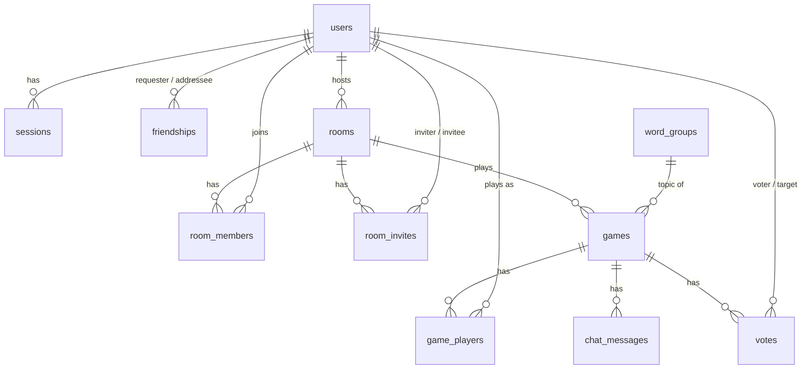

*This project has been created as part of the 42 curriculum by hakobori, tkusama, skomatsu, mishimod, mamiyaza.*

# Word Wolf — Detective Edition

## Description

**Word Wolf — Detective Edition** is a real-time, browser-based social deduction game
for 3–8 players, set in a Victorian detective world.

At the start of each game, every player secretly receives one word. Most players
(the *citizens*) share the same word. One player (the *word wolf*) gets a word that is
similar but different, for example "beach" and "pool". **Nobody is told which side
they are on.** The players discuss in a time-limited chat, try to work out who has the
odd word, and then vote. The citizens win if the wolf gets the most votes. Otherwise
the wolf wins.

The goal of the project is to build a complete multiplayer web application. It has a
server-authoritative game engine, real-time communication, persistent user accounts
and a social layer, and it starts with a single command.

### Key features

- **Real-time games**: 3–8 players per game. The server drives every phase
  (`LOBBY → DEALING → DISCUSSION → VOTING → (COMEBACK) → RESULT → LOBBY`) and
  pushes the state to all clients.
- **Discussion chat**: chat over WebSockets during the discussion phase. Messages are
  stored, so the history comes back after a page reload.
- **Disconnection handling**: if a player drops, the game pauses. Players get a
  fixed 20-second grace period to reconnect, and the game is aborted
  without a result if they don't.
- **Spectator mode**: users can join a room as spectators. They watch the game live
  but cannot chat or vote.
- **Rooms**: create rooms with a name, topic genres and timers. Join a room with its
  invite code, invite friends, mark yourself ready, and let the host remove members.
- **Comeback mode** (optional, per room): when the wolf is caught, they get 30 seconds
  to guess the citizens' word and win anyway.
- **Accounts and social features**: registration and login with email and password,
  avatars, profiles with game history and statistics, friends, and live online status
  (`ONLINE` / `IN_GAME` / `OFFLINE`).
- **Legal pages**: a Privacy Policy and Terms of Service, linked from the login,
  registration and profile pages.

## Instructions

### Prerequisites

| Software | Version | Notes |
| --- | --- | --- |
| Docker Engine | 24+ | Runs all services |
| Docker Compose | v2 (`docker compose`) | |
| GNU Make | any | Entry point for every command |
| OpenSSL | any | Generates secrets in `.env.production` |
| Google Chrome | latest stable | Supported browser |

Node.js 24 is only needed on the host for development mode (`make dev`). Production
mode builds everything inside containers.

### Run (production mode)

```sh
git clone <this repository> && cd <repository>
make
```

`make` does three things:

1. **Creates `.env.production`** (`make setup`) with a random database password and
   Phoenix `SECRET_KEY_BASE`. The file is git-ignored, and an existing file is never
   overwritten. The template for development is `.env.example`.
2. **Builds and starts** PostgreSQL, the Phoenix backend (`MIX_ENV=prod`), the static
   frontend build, and Caddy as the HTTPS reverse proxy.
3. **Runs migrations** and loads the word topics. No demo users are created.

Then open **https://localhost:8443** and register an account at `/register`. Caddy uses
a local certificate authority, so accept the browser warning the first time. Run
`make ca-cert` to export the root certificate if you want to trust it.

Useful variables in `.env.production`:

| Variable | Purpose |
| --- | --- |
| `APP_PORT` | HTTPS port (default `8443`). Change it if you run `make dev` at the same time |
| `LAN_HOST` | This machine's IP address, so other devices on the same network can join |

### Common commands

| Command | Action |
| --- | --- |
| `make` | Set up, build and start production mode |
| `make down` | Stop production mode (keeps the database) |
| `make re` | Rebuild and restart (keeps the database) |
| `make clean` | Remove containers and local build output (keeps the database and certificates) |
| `make fclean` | Also delete the database, certificates, images and dependencies. **Deletes all users and game history** |
| `make dev` | Start development mode (Vite hot reload and demo seed users, password `password123`) |
| `make help` | List all tasks |

### Tests

```sh
cd frontend && npm ci && npm test && npm run build      # frontend tests + type check
docker compose run --rm -e MIX_ENV=test backend mix test # backend tests
```

Detailed Japanese instructions for the team are in
[_docs/dev/getting-started.md](_docs/dev/getting-started.md).

## Team Information

| Login | GitHub | Role(s) | Responsibilities |
| --- | --- | --- | --- |
| hakobori | hanabanana111 | Product Owner, Developer | Defines the product vision and game rules, prioritizes features, and validates finished work |
| tkusama | yayoi111 | Project Manager, Developer | Runs meetings, tracks progress and deadlines, manages risks, and integrates work into `develop` / `main` |
| skomatsu | otnk666 | Tech Lead / Architect, Developer | Defines the architecture and tech stack, owns the API contracts, and reviews important changes |
| mishimod | Jasmine-Gray | Service Designer, Developer | Designs the UI, the screen flow and the detective visual identity |
| mamiyaza | 555fire | Content Designer, Developer | Creates and expands game data and content |

All five members are developers. They implement features, review each other's pull
requests, write tests and maintain the documentation.

## Project Management

- **Work split**: the work is divided into four lanes with clear directory ownership,
  so members rarely edit the same files:
  - **Lane A**: game engine backend (GameServer and Channels)
  - **Lane B**: real-time frontend
  - **Lane C**: persistence backend (REST and Ecto)
  - **Lane D**: REST frontend and infrastructure

  See [_docs/dev/conventions.html](_docs/dev/conventions.html).
- **Contract-first workflow**: every endpoint and event is defined first in
  [openapi.yaml](_docs/spec/api/openapi.yaml) (REST) and
  [asyncapi.yaml](_docs/spec/api/asyncapi.yaml) (WebSocket). `make gen` generates the
  TypeScript and Elixir types, so the frontend and backend can be built in parallel
  against a mock server (`make mock`).
- **Git workflow**: feature branches named `<lane>/<topic>` come off `develop` and are
  merged through reviewed pull requests. `main` only holds stable releases. Commits
  use the `feat: / fix: / refactor: / docs: / test: / chore:` prefixes.
- **Tools**: GitHub (repository, pull requests, reviews), Notion (task board and
  calendar), draw.io (diagrams), and a UI mock of all screens in [_docs/mock/](_docs/mock/).
- **Communication**: regular team meetings (minutes in [_docs/agenda/](_docs/agenda/))
  and a team chat channel for daily coordination.

## Technical Stack

| Layer | Technology | Why we chose it |
| --- | --- | --- |
| Frontend | React 19, TypeScript (strict), Vite, Tailwind CSS 4, shadcn/Base UI, wouter, react-hook-form + zod, Motion | A widely used, well-documented ecosystem. Strict typing combined with generated API types catches contract mismatches at compile time |
| Backend | Elixir, Phoenix 1.8 (REST and Phoenix Channels), Bandit | The BEAM handles many concurrent connections well. Each room runs as its own supervised process (`GameServer`), so room state, timers and reconnection stay isolated and fault-tolerant. Channels and Presence give us WebSockets out of the box |
| Database | PostgreSQL with Ecto | A relational schema fits users, friendships, rooms and games. Ecto gives migrations, changesets and validation |
| API contracts | OpenAPI 3 and AsyncAPI 3, openapi-typescript, openapi-fetch, open_api_spex, Prism | A single source of truth for both sides, generated types, and a mock server so the frontend and backend can be developed in parallel |
| Infrastructure | Docker Compose, Caddy | One-command startup. Caddy terminates HTTPS automatically with a local CA |
| Quality | Vitest and Testing Library, ExUnit, oxlint, Prettier, Credo, Sobelow, mix_audit | Tests, linting and security checks on both sides |

Passwords are hashed with bcrypt. API sessions use random bearer tokens, and only their
hashes are stored in the database.

## Database Schema



All tables use string IDs. Field types below follow the Ecto schemas; `string[]`
denotes an array of strings, and `utc_datetime_usec` is a UTC datetime with
microsecond precision.

| Table | Purpose | Key fields and types |
| --- | --- | --- |
| `users` | Accounts and profiles | `email: string` (unique), `password_hash: string`, `display_name: string`, `avatar_url: string`, `bio: string`, `presence_state: string`, `ws_connection_count: integer`, `terms_accepted_at: utc_datetime_usec` |
| `sessions` | Login sessions | `user_id: string`, `token_hash: string`, `expires_at: utc_datetime_usec`, `last_used_at: utc_datetime_usec` |
| `friendships` | Friend requests and friends | `requester_id: string`, `addressee_id: string`, `status: string` (`PENDING` / `ACCEPTED` / `DECLINED`) |
| `rooms` | Rooms and their settings | `host_user_id: string`, `room_name: string`, `invite_code: string`, `status: string`, `genres: string[]`, `discussion_ms: integer`, `vote_ms: integer`, `min_players: integer`, `max_players: integer`, `reconnect_grace_ms: integer`, `comeback_enabled: boolean` |
| `room_members` | Who is in a room | `room_id: string`, `user_id: string`, `participant_type: string` (`PLAYER` / `SPECTATOR`), `ready: boolean`, `connected: boolean` |
| `room_invites` | Friend invitations to rooms | `room_id: string`, `inviter_id: string`, `invitee_id: string`, `status: string` |
| `word_groups` | Topic sets by genre | `genre: string`, `words: string[]`, `active: boolean` |
| `games` | One played game | `room_id: string`, `word_group_id: string`, `phase: string`, `phase_version: integer`, `deadline: utc_datetime_usec`, `paused: boolean`, `winner: string`, `result_reason: string`, `comeback_result: map`, `started_at: utc_datetime_usec`, `ended_at: utc_datetime_usec` |
| `game_players` | Participants of a game | `game_id: string`, `user_id: string`, `participant_type: string`, `role: string`, `assigned_word: string`, `connected: boolean` |
| `chat_messages` | Discussion chat history | `game_id: string`, `user_id: string`, `content: string`, `sent_at: utc_datetime_usec` |
| `votes` | Votes cast in a game | `game_id: string`, `voter_user_id: string`, `target_user_id: string`, `voted_at: utc_datetime_usec` |

Migrations are in [backend/priv/repo/migrations/](backend/priv/repo/migrations/).

## Features List

| Feature | Description | Implemented by |
| --- | --- | --- |
| Registration and login | Email and password with frontend and backend validation, bcrypt hashing, bearer sessions, route guard (`AuthGate`) | skomatsu |
| Logout and account deletion | Revokes the session and closes the user's WebSockets. Deletes the account | hakobori |
| Home screen | Profile summary, current room, aggregate game statistics and friend count from `GET /users/me` | hakobori |
| Profiles and avatars | Avatar picker and upload, profile page, game statistics and history, viewing other players' profiles | mishimod, tkusama |
| Friends | Search, send, accept and decline friend requests, friend list | mishimod |
| Online status | Live `ONLINE` / `IN_GAME` / `OFFLINE` status for friends | hakobori, tkusama |
| Rooms and lobby | Create rooms, join by invite code, friend invites with real-time notifications, ready state, leaving, host controls (settings, removing members) | mishimod, tkusama |
| Game engine | One supervised process per room. Server-driven phases with timers, role and word assignment, voting, results, persistence | skomatsu |
| Game screens | Countdown, word reveal, discussion, voting and result screens, driven by server phase events | skomatsu, tkusama |
| Discussion chat | WebSocket chat with rate limiting, stored history, optimistic sending | hakobori |
| Reconnection | Pause on disconnect, grace period, state recovery after a reload | skomatsu, tkusama |
| Spectator mode | Join as a spectator, live read-only view, switch between player and spectator in the lobby | tkusama |
| Comeback mode and topics | The wolf's last-chance guess. Topic groups by genre, without repeating the previous game's topic | tkusama |
| Victorian UI | Detective visual theme, animated backgrounds, cinematic transitions, mobile layout | mishimod, tkusama, skomatsu |
| Privacy Policy and Terms of Service | Pages with project-specific content, linked from the login, registration and profile pages | skomatsu |
| One-command deployment | Production Docker stack with HTTPS, `make` lifecycle targets | tkusama |

## Modules

Total: **17 points** (7 Major × 2 + 3 Minor × 1). 14 points are required, and the
extra points are a margin.

| # | Module | Type | Pts | Implemented by |
| --- | --- | --- | ---: | --- |
| 1 | Web-based game | Major | 2 | skomatsu, tkusama |
| 2 | Remote players | Major | 2 | skomatsu, tkusama |
| 3 | Multiplayer game (more than 2 players) | Major | 2 | skomatsu |
| 4 | Real-time features with WebSockets | Major | 2 | skomatsu, hakobori |
| 5 | User interaction (chat, profiles, friends) | Major | 2 | hakobori, mishimod |
| 6 | Standard user management | Major | 2 | mishimod, skomatsu, hakobori |
| 7 | Frameworks for both frontend and backend | Major | 2 | All members |
| 8 | Spectator mode | Minor | 1 | tkusama |
| 9 | Use an ORM for the database | Minor | 1 | skomatsu, hakobori, tkusama |
| 10 | Game customization options | Minor | 1 | tkusama, mishimod |
| | **Total** | | **17** | |

### Why we chose these modules and how we implemented them

1. **Web-based game**: Word Wolf is the product itself. The rules (phases, timers,
   secret words, voting, results) run on the server in `WordWolf.Games.GameServer`, so
   clients cannot cheat by changing the state locally.
2. **Remote players**: players on different computers play together through the HTTPS
   endpoint. If someone drops, the game pauses for the grace period. Clients restore
   the full state with `state.request` after reconnecting or reloading, and the game
   stops without a result if a player does not come back.
3. **Multiplayer (3–8 players)**: a social deduction game needs a group. The server is
   the single authority and serializes all actions per room in one process, so votes
   and phase changes stay consistent for everyone.
4. **WebSockets**: phase changes, vote progress, chat, lobby updates, invitations and
   online status all have to be instant. We use Phoenix Channels: a `room:{roomId}`
   channel for game and chat events and a `user:{userId}` channel for private data
   (your own word) and notifications. Every event is described in AsyncAPI.
5. **User interaction**: chat is the core of the game. Players can open each other's
   profiles, send friend requests, see their friends' status and invite friends to rooms.
6. **Standard user management**: secure accounts, editable profiles, avatars (with a
   default), friends with online status, and a profile page with statistics and game
   history.
7. **Frameworks**: React on the frontend and Phoenix on the backend, chosen for the
   reasons in [Technical Stack](#technical-stack).
8. **Spectator mode**: it fits the "invite your friends to watch the investigation"
   idea. Spectators join through an invite link, see the public game state, all
   players' words and roles, and read the chat live. They cannot send chat messages
   or vote. The backend enforces spectator permissions with `participant_type`.
9. **ORM**: the data is relational (users, friendships, rooms, games, votes), so we
   wanted schemas and validation in one place. We use **Ecto**: every table is mapped
   to an Ecto schema with typed fields and associations. User input (accounts,
   sessions, rooms, room members, invites) is validated on the server with
   changesets. The database structure is versioned with migrations
   ([backend/priv/repo/migrations/](backend/priv/repo/migrations/)), and queries are
   written with `Ecto.Query` in the context modules (`Accounts`, `Friends`, `Rooms`,
   `Games`, `Chat`) instead of raw SQL.
10. **Game customization**: groups like different game lengths and topics, and a
    short game helps new players learn the rules. When the host creates a room, or
    later in the lobby, they can change:
    - **Topic genres**: places, food, hobbies, daily items, school and work,
      entertainment. Topics are picked at random from the selected genres, and
      the room never gets the same topic twice in a row.
    - **Discussion and voting time**.
    - **Comeback mode**: a special ability for the wolf. When caught, the wolf gets
      30 seconds to guess the citizens' word and win anyway.

    Every setting has a default (all genres, 5 min discussion, 30 s vote, comeback
    off), so a room can start without changing anything. The settings are stored in
    the `rooms` table, validated on the server, and pushed to everyone in the lobby
    in real time.

## Individual Contributions

- **tkusama** (GitHub: yayoi111): integrated the screens with the real backend. Built spectator
  mode, comeback mode, genre topic groups, lobby host controls, three-player games,
  configurable timers, the profile game history, mobile layout fixes, and the
  production one-command startup. *Challenge*: keeping the game screens correct across
  reloads and sleep or resume. *Solution*: rebuild the state from the server
  (`state.request` and the stored chat history) instead of trusting client state.
- **skomatsu** (GitHub: otnk666): built the game engine (one `GameServer` process per room with a
  supervision tree, public and private payloads), the room and user Channels, the first
  full implementation of the REST endpoints in the contract, game persistence, the phase-driven game screen,
  login and registration, the auth session hook, and the legal pages. *Challenge*:
  keeping each player's word secret while still broadcasting the shared state.
  *Solution*: a public `room.state` for everyone and a `private.state` sent only on
  each user's own channel.
- **mishimod** (GitHub: Jasmine-Gray): built avatar upload and selection, the profile pages, friends
  (search, request, accept, decline), room creation, joining by invite code, friend game invites
  with real-time notifications, leaving rooms, and the animated Victorian background.
  *Challenge*: the avatar flickered between screens. *Solution*: a global cache of the
  current user, set up before the first render.
- **hakobori** (GitHub: hanabanana111): designed the database (ER diagram and table specs), built the home
  screen and `GET /users/me`, the discussion chat (history endpoint, WebSocket send
  with rate limiting, chat component), logout with WebSocket disconnect, account
  deletion, and friend online status. *Challenge*: the rules for who may chat differ
  from who may read. *Solution*: only players can send during the discussion phase,
  and spectators can read the history and receive messages live.
- **mamiyaza** (GitHub: 555fire):
  Created and expanded the game's data and content, including questions, topics, and genre-based categories.
  Organized and reviewed game content to ensure consistency and variety across different topics.
  Integrated the content into the game data structure so it could be used by the game engine.
  *Challenge*: keeping the game content varied, consistent, and suitable for different genres.
  *Solution*: organized content into genre-based groups and reviewed the entries for relevance, clarity, and consistency.

## Resources

### References

- [Phoenix documentation](https://hexdocs.pm/phoenix/overview.html) and
  [Phoenix Channels](https://hexdocs.pm/phoenix/channels.html)
- [Ecto documentation](https://hexdocs.pm/ecto/Ecto.html)
- [Elixir GenServer and Supervisor guides](https://hexdocs.pm/elixir/genservers.html)
- [React documentation](https://react.dev/) and [Vite](https://vite.dev/guide/)
- [Tailwind CSS](https://tailwindcss.com/docs) and [shadcn/ui](https://ui.shadcn.com/)
- [OpenAPI Specification](https://spec.openapis.org/oas/latest.html),
  [AsyncAPI Specification](https://www.asyncapi.com/docs/reference/specification/latest),
  [openapi-typescript / openapi-fetch](https://openapi-ts.dev/)
- [Caddy documentation](https://caddyserver.com/docs/) and
  [Docker Compose](https://docs.docker.com/compose/)
- Internal documentation: [_docs/](_docs/README.md) (requirements, game rules, API
  contracts, architecture, development guide)

### Use of AI

We used AI assistants (Claude Code, GitHub Copilot, Codex) to save time on repetitive
work. Every result was read, tested and reviewed by a team member, and by another member
in a pull request, before it was merged. Each member can explain all the code in their
area.

- **Code**: scaffolding React components from the UI mock, Ecto
  contexts and controllers that follow the existing reference endpoint, and test cases.
  Contract changes and design decisions (game rules, authorization, the process model)
  were made by the team.
- **Documentation**: summarizing the subject, drafting specifications and this README.
- **Debugging and review**: explaining error messages and finding bugs in diffs.
- **Art**: the character avatars and some background images were generated with an
  AI image tool from prompts written by the team. The prompts are recorded in
  [_docs/dev/character-art-prompts.md](_docs/dev/character-art-prompts.md).

Shared rules for AI tools are in [AGENTS.md](AGENTS.md).
