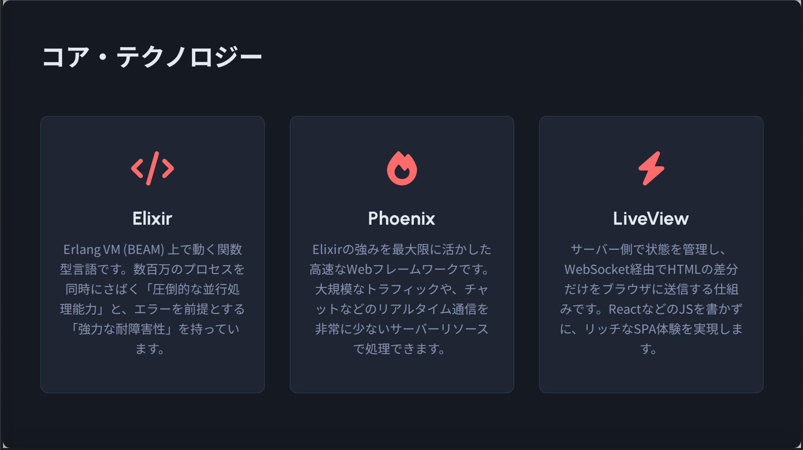
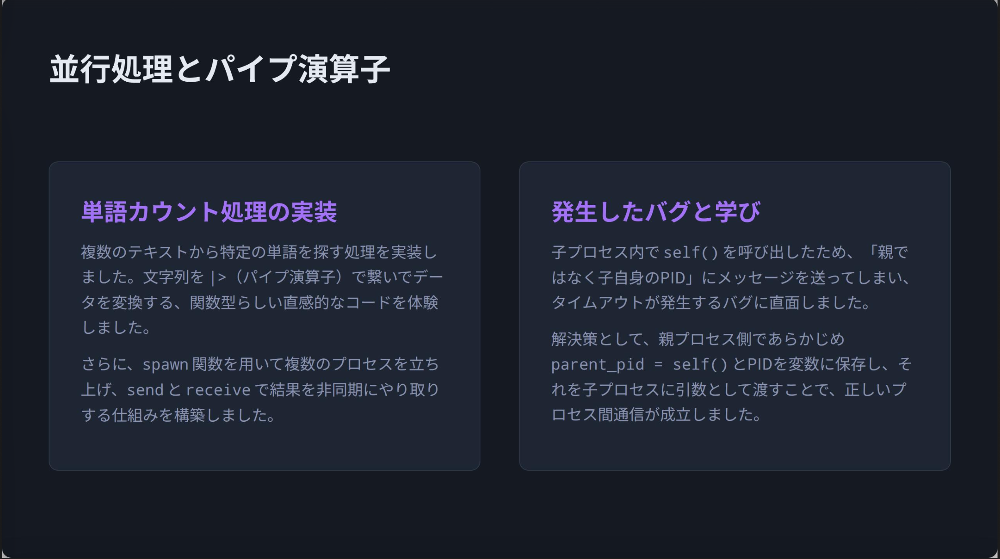
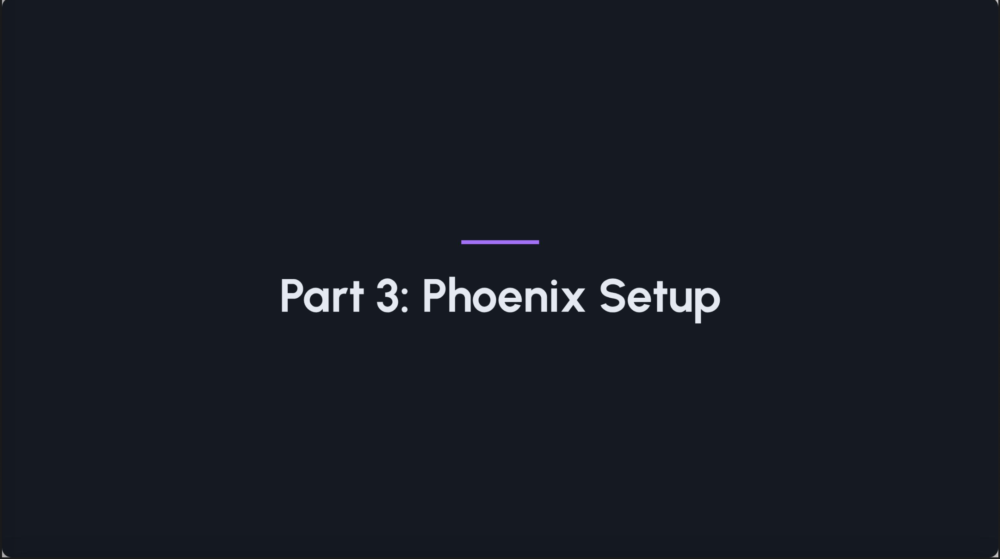
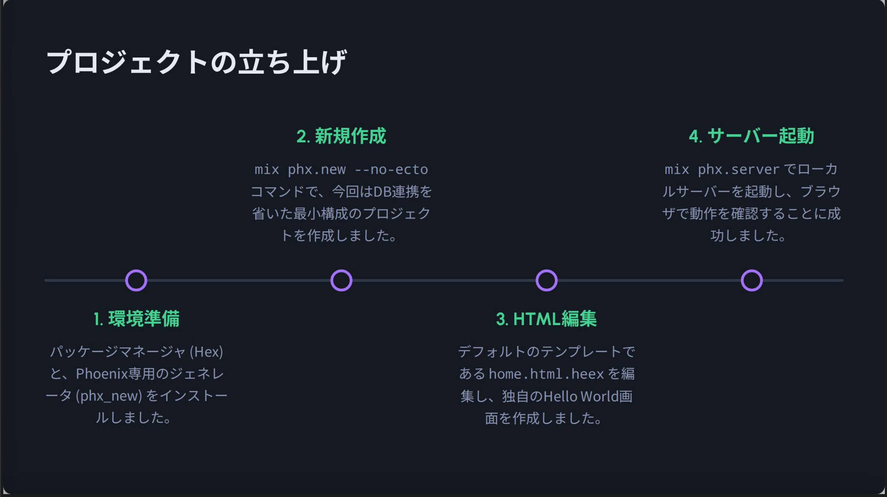
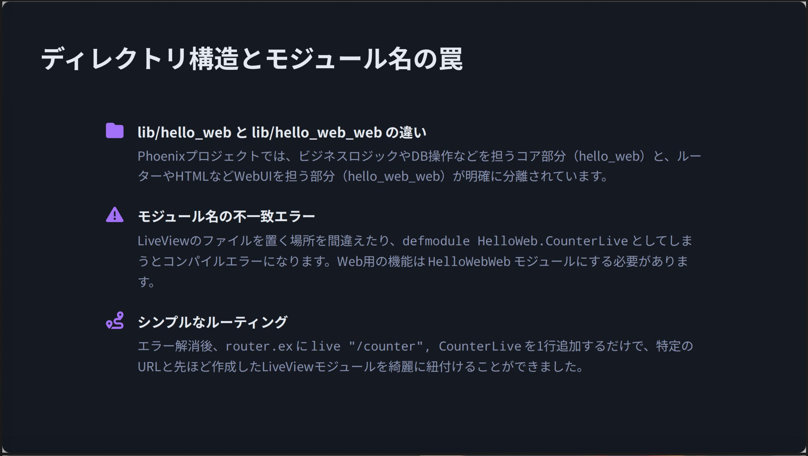
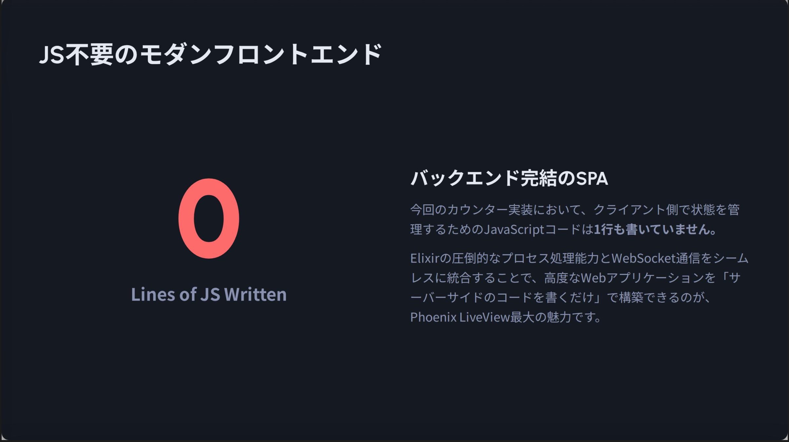

# Phoenix LiveView カウンター実装チュートリアル

## 1. Elixir & Phoenix とは？
* **Elixir**: 軽量プロセスと高い並行処理能力を持つ関数型言語。
* **Phoenix**: Elixirをベースにした高速なWebフレームワーク。
* **LiveView**: JavaScriptをほとんど書かずに、サーバー側とWebSocketで通信してリアルタイムな画面更新を行うPhoenixの強力な機能。

## 2. 最初のつまづき：ディレクトリ構造の罠
Phoenixプロジェクト（`hello_web`）を作成した際、`lib` 以下に似たディレクトリが2つできるため注意が必要です。
* `lib/hello_web/`: データベースやシステム裏側のコアラジックを置く場所。
* `lib/hello_web_web/`: ルーターや画面（HTML）など、Web表示に関わるものを置く場所。
※ 画面のルーティング（`router.ex`）を追加する際は、必ず **`_web` が連続する方**を編集すること。

## 3. 並行処理のバグと解決（プロセス間通信）
Elixirの強力な機能であるプロセス間通信（`send` / `receive`）を実装する際の注意点。
* **失敗例**: 子プロセスの中で `self()` を呼ぶと、親ではなく自分自身のPIDを取得してしまい、結果を親に返せない（タイムアウト発生）。
* **解決策**: メイン処理（親プロセス）で先に `self()` でPIDを取得し、それを引数として子プロセス（`spawn`）に渡すことで解決。

## 4. LiveViewによるカウンター実装
`lib/hello_web_web/live/counter_live.ex` を作成し、以下のようにモジュールを定義。

* `mount/3`: 初期状態（カウンターの値を0）をセット。
* `render/1`: 画面のHTMLを描画。ボタンに `phx-click="inc"` などを設定。
* `handle_event/3`: ボタンが押されたときのアクションを受け取り、状態（値）を更新。

**結果**: JavaScriptを書くことなく、ボタンを押すとリアルタイムに数字が増減するカウンターが完成！

## スライド資料

  
    
  
    
  
    
  
    
  
    
  
    
  
    
  
    
  
    
  
    
  
    

