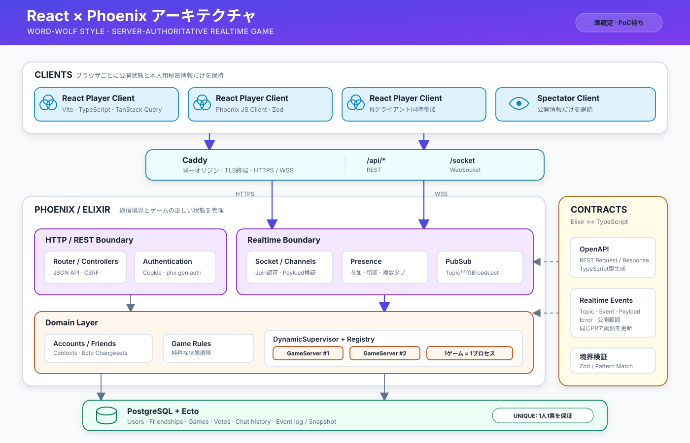

# Architecture

> 最終更新: 2026-08-16

このディレクトリは、ft_transcendence の技術構成とアーキテクチャ方針を管理する。

## 現在のステータス

**準確定（PoCで最終確認予定）**

- フロントエンド: React + Vite + TypeScript
- バックエンド: Elixir + Phoenix
- リアルタイム通信: Phoenix Channels + Presence
- データベース: PostgreSQL + Ecto
- スタイリング: Tailwind CSS
- HTTPS / リバースプロキシ: Caddy
- 起動: Docker Composeによる1コマンド起動

最終確定前に、複数ブラウザ接続、秘密情報の個別配信、同時投票、切断・再接続を含むPoCを実施する。

## ドキュメント

- [構成図（SVG）](react-phoenix-architecture.svg)
- [技術スタック](tech-stack.md)
- [予定ディレクトリ構成](directory-structure.md)
- DB設計: [テーブル設計](db-wwolf-updated.md) / [ER図](db-wwolf-er-mermaid.md) / Ecto migration
- リアルタイム構成: [asyncapi.yaml](../spec/api/asyncapi.yaml) と[バックエンド仕様](../spec/backend/backend-spec.md)

## 関連資料

- [Subject要件](../requirements/requirements.md)
- [確定事項](../requirements/decisions.md)
- [技術スタック比較](../requirements/tech-stack-comparison.md)
- [モジュール構成案](../requirements/module-plan.md)
