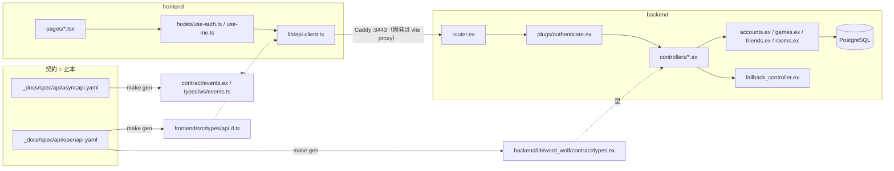
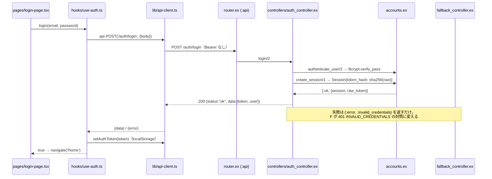
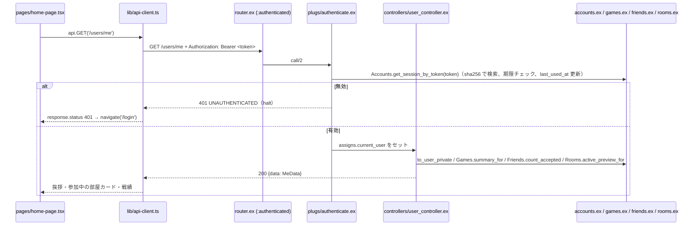

# コードの流れ（読書会ガイド）

> 最終更新: 2026-09-02（develop、socket 認証と LAN アクセスまで）

いま動いている縦串は **登録 → アバター設定 → ホーム** と **ログイン → ホーム** の 2 本。
このページはその 2 本を、ブラウザから DB まで、ファイル名を追いながら一周する。
各ファイルの冒頭ヘッダー（Created / Authors / 役割 / 契約 / 関連）と合わせて読む。

## 0. 全体像



- 契約が唯一の正本。型は手書きせず `make gen` で両側に生成する（AGENTS.md）。
- FE は `openapi-fetch` の `api.GET('/users/me')` のように **契約のパスをそのまま呼ぶ**。BE は同じパスを `router.ex` に書く。
- UI の見た目は `_docs/mock/` が正。画面はモックから移植し、データ境界だけを契約型に差し替える。

## 1. 起動と配線

| 何 | どこ | メモ |
|---|---|---|
| 起動 | `make up`（`Makefile`） | `docker compose up -d --build` → 最後に `make urls` でアクセス先を表示 |
| サービス | `compose.yaml` | db / pgweb / backend(:4000) / frontend(vite :5173) / proxy(Caddy :8443) |
| 振り分け | `_tools/caddy/Caddyfile` | `/health /auth/* /users/* /rooms/* /games/* /friends/* /socket/*` → backend、それ以外 → frontend |
| ローカル dev | `frontend/vite.config.ts` | Caddy を通さず `npm run dev` するときは同じ表で :4000 へ proxy |
| 向き先 | `frontend/src/lib/api-client.ts` | `VITE_API_BASE` 未指定 = 同一オリジン。`:4010` なら prism mock、`:4000` なら実 BE 直 |
| BE 起動時 | `compose.yaml` の `backend.command` | `ecto.create → ecto.migrate → seeds.exs → phx.server` |
| 別端末から | `.env` の `LAN_HOST=<この PC の IP>` → `docker compose up -d proxy` | 同じ Wi-Fi のスマホ等から `https://<IP>:8443`。Caddy は IP にも内部 CA で証明書を出す。`default_sni` で SNI なし接続にもその証明書を使う（Docker NAT 対策）。警告を消すなら `make ca-cert` の root.crt を端末に入れる |
| WebSocket | `backend/lib/word_wolf_web/endpoint.ex` の `socket "/socket"` → `channels/user_socket.ex` | `connect` パラメータ `token` を REST と同じ `Accounts.get_session_by_token/1` で照合し `socket.assigns.user_id` を置く。FE は `frontend/src/lib/channel-client.ts` の `createSocket()`（`getAuthToken()` を渡すので別タブ = 別ユーザーで接続） |

契約にパスを足したら **Caddyfile の `@backend` と vite.config.ts の proxy の両方**を更新する。

## 2. 契約から型へ

```
_docs/spec/api/openapi.yaml ──(npx openapi-typescript)──▶ frontend/src/types/api.d.ts
                            ──(_tools/gen-contract-types.py)──▶ backend/lib/word_wolf/contract/types.ex
_docs/spec/api/asyncapi.yaml ──(同上)──▶ contract/events.ex, frontend/src/types/ws/events.ts
```

- FE: `import type { components, paths } from '@/types/api'` → `components['schemas']['MeData']` など。
- BE: `@spec ... :: Types.me_data()` のように `WordWolf.Contract.Types` を `@spec` に使う。
- 生成物は手編集禁止。`make gen-check` が差分を検出する。エンドポイント追加の手順は `.claude/skills/add-endpoint`。

## 3. 縦串① ログイン / 登録（画面01・02）



読む順:

1. `frontend/src/pages/login-page.tsx` — zod + react-hook-form。送信で `useAuth().login`。登録は `register-page.tsx` → 成功で `/avatar/setup`
2. `frontend/src/hooks/use-auth.ts` — `api.POST` を呼び、成功なら `setAuthToken`。エラーコード → 日本語は `errorMessage`
3. `frontend/src/lib/api-client.ts` — `createClient<paths>`。**トークンの保存先はここだけ**。middleware が全リクエストに `Authorization: Bearer` を付ける
4. `backend/lib/word_wolf_web/router.ex` — `/auth/*` は `:api`（認証不要）、`/users/me` 系は `:authenticated`
5. `backend/lib/word_wolf_web/controllers/auth_controller.ex` — `with` で成功経路だけ書く。`action_fallback` で失敗を F へ
6. `backend/lib/word_wolf/accounts.ex` — `register_user`（changeset → 重複メールは `:email_taken`）、`authenticate_user`、`create_session`、`hash_token`（SHA-256）
7. `backend/lib/word_wolf/accounts/user.ex` / `session.ex` — スキーマと changeset。パスワードは `password_hash`（bcrypt）だけ保存
8. `backend/lib/word_wolf_web/controllers/fallback_controller.ex` — `{:error, reason}` → 契約 `ErrorResponse`（401 / 400 / 404 / 409）

## 4. 縦串② ホーム（画面04）と認証 Plug

認証と WebSocket の全体図は [../diagrams/auth-socket.md](../diagrams/auth-socket.md)。



読む順:

1. `frontend/src/pages/home-page.tsx` — `MeData` を表示。勝率はクライアント導出（契約は `winRate` を持たない）
2. `backend/lib/word_wolf_web/plugs/authenticate.ex` — Bearer を取り出し、`current_user` / `current_session` を assigns に置く
3. `backend/lib/word_wolf_web/controllers/user_controller.ex` — `show`（MeData 組み立て）、`update`、`update_avatar`
4. `backend/lib/word_wolf/games.ex` / `friends.ex` / `rooms.ex` — いまは `GET /users/me` 用の参照系だけ。`rooms.ex` は契約 `RoomPreview`（`spectatorCount` / `joinable` 必須）を返す

## 5. 縦串③ アバター設定・プロフィール（画面03・22）

- `frontend/src/hooks/use-me.ts` — `refreshMe`（GET /users/me）、`updateAvatarPreset`（PUT /users/me/avatar, JSON `presetId`）、`uploadAvatarFile`（同パスに multipart。`bodySerializer` で FormData）、`updateProfile`（PUT /users/me）
- `frontend/src/pages/avatar-setup-page.tsx` — プリセットを選び PUT → `/home`。`frontend/src/data/avatar-options.ts` の id は BE の `@avatar_presets` と一致させる
- `backend/lib/word_wolf/accounts.ex` — `update_user_avatar/2`（プリセット or `%Plug.Upload{}` → `priv/static/uploads/avatars/`）、`update_user_profile/2`
- `backend/lib/word_wolf_web.ex` の `static_paths` に `avatars uploads` があるのでアップロード画像は BE が配信する

## 6. データ

| 何 | どこ |
|---|---|
| テーブル | `backend/priv/repo/migrations/20260822032759_create_mvp_tables.exs`（users / sessions / friendships / rooms / room_members / word_pairs / games / game_players / chat_messages / votes） |
| スキーマ | `backend/lib/word_wolf/{accounts,rooms,games,friends}/*.ex`。id は文字列主キー（`user_xxx`, `sess_xxx`） |
| 設計 | `_docs/architecture/db-wwolf-updated.md` |
| 開発シード | `backend/lib/word_wolf/dev_seeds.ex`（投入口は `priv/repo/seeds.exs`）。全員のパスワードは `password123`、田中 ユウ の Bearer は `dev-token-yu` |
| 複数人デバッグ | 開発時のみ `/dev/as`（`frontend/src/pages/dev-login-page.tsx`）。シードは `/dev/as/<name>` で即ログイン、自分で登録したプレイヤーはページ内のフォーム（`useAuth({ scope: 'tab' })` → `POST /auth/login`）でログイン。どちらも `sessionStorage` にタブ単位で書くので、別タブ = 別ユーザー。`lib/api-client.ts` の `getAuthToken` は sessionStorage → localStorage → `VITE_DEV_AUTH_TOKEN` の順に読む |

## 7. テスト

| 層 | ファイル | 実行 |
|---|---|---|
| BE 結合 | `backend/test/word_wolf_web/controllers/auth_controller_test.exs`（登録・ログイン → 発行トークンで /users/me が通る）、`user_controller_test.exs`（fixture と DevSeeds の両方） | `docker compose run --rm -e MIX_ENV=test backend mix test` |
| BE 単体 | `backend/test/word_wolf/accounts_test.exs` | 同上 |
| FE 単体 | `frontend/src/hooks/use-auth.test.ts`、`frontend/src/lib/api-client.test.ts`、`frontend/src/pages/home-page.test.tsx` | `cd frontend && npm test` |
| 契約適合 | `make proxy`（prism が実 BE のレスポンスを契約と照合） | BE 起動後 |

## 8. まだ無いもの（骨格だけのファイル）

| レーン | 骨格ファイル | 契約 |
|---|---|---|
| A | `backend/lib/word_wolf/games/game_server.ex`、`backend/lib/word_wolf_web/channels/{room_channel,user_channel}.ex`（`user_socket.ex` の接続認証は済み。チャンネル登録の行を有効化するところから） | `asyncapi.yaml` の channels 全部 |
| B | `frontend/src/hooks/use-{room,user}-channel.ts`（`channel-client.ts` の `createSocket()` は済み）、`frontend/src/pages/{lobby,word-reveal,discussion,vote,game-countdown,game-result}-page.tsx` | 画面 08–20 |
| C | `backend/lib/word_wolf_web/controllers/{room,game,friend}_controller.ex`（`rooms.ex` / `games.ex` / `friends.ex` の書き込み系） | rooms / invites / games / friends タグ |
| D | `frontend/src/pages/{room-search,room-invite,room-create,friends}-page.tsx` | 画面 05–07・21 |

小さな穴: `POST /auth/logout`、`GET /users/me/games`（プロフィールの「最近の対戦」が fixture のまま）、`DELETE /users/me`。

## 10. Elixir / Phoenix の書き方を、実装済みエンドポイントで読む

Phoenix の「標準的な形」は phx.gen が吐くコードと phx.gen.auth の認証コードにほぼ集約される。
このリポジトリの 5 エンドポイントはその形に沿っている。認証前（`/auth/*`）と認証後（`/users/me`）で
**「本人をどう決めるか」だけが違う**ので、そこを対比する。

### 10.1 ルーターで状況を分ける（`router.ex`）

```elixir
pipeline :api do                         # 認証不要のパイプライン
  plug :accepts, ["json"]
end

pipeline :authenticated do               # Bearer 必須のパイプライン
  plug :accepts, ["json"]
  plug WordWolfWeb.Plugs.Authenticate    # ← モジュール Plug。conn.assigns.current_user を置く
end

scope "/", WordWolfWeb do
  pipe_through :api
  post "/auth/login", AuthController, :login     # 「POST /auth/login は AuthController.login/2」
end

scope "/", WordWolfWeb do
  pipe_through :authenticated
  get "/users/me", UserController, :show
end
```

- `pipeline` は Plug の列。`pipe_through` で scope 内の全ルートに前処理を掛ける。認証の有無を**ルーターで宣言**し、コントローラは「もう本人は分かっている」前提で書く。これが Phoenix の標準。
- `plug :accepts` は関数 Plug（atom）、`plug WordWolfWeb.Plugs.Authenticate` はモジュール Plug。どちらも `conn -> conn` の変換。

### 10.2 認証前: 本人はリクエスト本文から（`auth_controller.ex`）

```elixir
defmodule WordWolfWeb.AuthController do
  use WordWolfWeb, :controller                  # json/2, put_status/2, action_fallback などを取り込む
  alias WordWolf.Accounts
  action_fallback WordWolfWeb.FallbackController # アクションが conn 以外を返したら Fallback.call/2 へ

  def login(conn, %{"email" => email, "password" => password}) do  # ① 関数ヘッドでパラメータをパターンマッチ
    with {:ok, user} <- Accounts.authenticate_user(email, password), # ② with: 成功経路だけを縦に書く
         {:ok, {_session, token}} <- Accounts.create_session(user) do
      json(conn, %{status: "ok", data: auth_session(token, user)})  # ③ 成功時だけ conn を返す
    end                                                              #    失敗は {:error, reason} がそのまま返り
  end                                                                #    action_fallback が受け取る

  def login(_conn, _params), do: {:error, :invalid_payload}         # ④ マッチしなかった形は別クローズで 400
end
```

- ① `%{"email" => email}`: JSON のキーは**文字列キー**で届く（atom ではない）。必須キーが無ければこのクローズにマッチせず ④ へ落ちる。バリデーションを if で書かない。
- ② `with` は `{:ok, x} <- expr` が成立する限り進み、崩れた値（`{:error, _}`）を**そのまま関数の戻り値**にする。`else` を書かないのが最近の推奨（エラー処理は 1 か所へ）。
- ③ `json/2` は `Phoenix.Controller` の関数。`conn |> put_status(:created) |> json(...)` のようにパイプで繋ぐ（`register` を参照）。
- ④ 複数クローズは上から順に試される。「正常形」→「それ以外」の順に並べるのが慣習。

### 10.3 認証後: 本人は `conn.assigns` から（`plugs/authenticate.ex` → `user_controller.ex`）

```elixir
defmodule WordWolfWeb.Plugs.Authenticate do
  import Plug.Conn                                  # assign/3, get_req_header/2, put_status/2, halt/1
  def init(opts), do: opts                          # Plug の 2 コールバック。init はコンパイル時
  def call(conn, _opts) do                          # call はリクエストごと
    case get_bearer_token(conn) do
      {:ok, token} ->
        case Accounts.get_session_by_token(token) do
          {:ok, session} ->
            conn
            |> assign(:current_session, session)    # ← ここで本人を確定させる
            |> assign(:current_user, session.user)
          {:error, :unauthenticated} -> unauthenticated_response(conn, "...")
        end
      {:error, :no_token} -> unauthenticated_response(conn, "...")
    end
  end

  defp get_bearer_token(conn) do
    case get_req_header(conn, "authorization") do
      ["Bearer " <> token] when byte_size(token) > 0 -> {:ok, String.trim(token)}  # 二進数パターン + ガード
      _ -> {:error, :no_token}
    end
  end

  defp unauthenticated_response(conn, message) do
    conn |> put_status(:unauthorized) |> json(%{...}) |> halt()   # halt/1 で後続の Plug・アクションを止める
  end
end
```

```elixir
defmodule WordWolfWeb.UserController do
  use WordWolfWeb, :controller
  action_fallback WordWolfWeb.FallbackController

  def show(conn, _params) do                                        # params は見ない。本人は assigns
    json(conn, %{status: "ok", data: me_data(conn.assigns.current_user)})
  end

  def update(conn, params) do
    user = conn.assigns.current_user                                # 「誰を更新するか」は params から取らない
    with {:ok, updated} <- Accounts.update_user_profile(user, params) do
      json(conn, %{status: "ok", data: Accounts.to_user_private(updated)})
    end
  end
end
```

- 認証前は `params` が本人を名乗る。認証後は **Plug が置いた `conn.assigns.current_user` が本人**で、`params` は「何を変えるか」だけ。`userId` を body で受けない。
- `"Bearer " <> token` は文字列の先頭一致パターン。`when byte_size(token) > 0` はガード。この 2 つで if 無しに形を絞る。
- `halt/1` を忘れると 401 を書いた後もアクションが走る。Plug で失敗したら必ず `halt`。

### 10.4 失敗の集約（`fallback_controller.ex`）

```elixir
def call(conn, {:error, :invalid_credentials}) do
  conn |> put_status(:unauthorized) |> json(error_envelope("INVALID_CREDENTIALS", "Invalid credentials."))
end

def call(conn, {:error, %Ecto.Changeset{} = changeset}) do         # 構造体パターン。changeset をそのまま受ける
  details = Ecto.Changeset.traverse_errors(changeset, fn {msg, opts} -> ... end)
  conn |> put_status(:bad_request) |> json(%{status: "error", error: %{code: "INVALID_PAYLOAD", details: details}})
end
```

`action_fallback` は「アクションが `%Plug.Conn{}` 以外を返したら `Fallback.call(conn, 戻り値)` を呼ぶ」だけの仕組み。
だからコントローラは成功経路だけを書き、`{:error, reason}` の語彙（`:invalid_credentials`, `:email_taken`, changeset）を
コンテキストと Fallback の間で揃えれば、契約の `ErrorResponse` が 1 か所で保証される。

### 10.5 コンテキストの形（`accounts.ex`, `accounts/user.ex`）

```elixir
def registration_changeset(user, attrs) do        # Ecto.Changeset のパイプライン。phx.gen.auth と同型
  user
  |> cast(attrs, [:email, :password, :display_name])
  |> validate_required([:email, :password, :display_name])
  |> validate_length(:password, min: 8)
  |> unique_constraint(:email)                     # DB の unique index 違反を changeset エラーに変換
  |> put_password_hash()
end

defp put_password_hash(%Ecto.Changeset{valid?: true, changes: %{password: password}} = changeset) do
  put_change(changeset, :password_hash, Bcrypt.hash_pwd_salt(password))   # valid? のときだけハッシュ
end
defp put_password_hash(changeset), do: changeset

def authenticate_user(email, password) when is_binary(email) and is_binary(password) do
  case Repo.get_by(User, email: email) do
    nil -> Bcrypt.no_user_verify(); {:error, :invalid_credentials}  # ユーザー不在でも同じ時間を使う（タイミング攻撃対策）
    %User{password_hash: hash} = user -> if valid_password?(password, hash), do: {:ok, user}, else: {:error, :invalid_credentials}
  end
end
```

- コンテキスト（`Accounts`）は **`{:ok, 値} | {:error, 理由}` を返す関数の集まり**。Web 層（controller / plug）は DB を直接触らない。これが Phoenix 1.3 以降の標準の層分け。
- `Repo.insert/1` は `{:ok, struct} | {:error, changeset}`。`register_user/1` はこれを `case` で受けて、重複メールだけ `{:error, :email_taken}` に言い換える（契約 409）。
- セッショントークンは `hash_token/1`（`:crypto.hash(:sha256, token) |> Base.encode64()`）で保存・検索。phx.gen.auth の email トークンと同じ方式で、生トークンを DB に置かない。
- `@spec update_user_profile(User.t(), map()) :: {:ok, User.t()} | {:error, Ecto.Changeset.t() | :invalid_payload}` のように、`@spec` に契約の型（`Types.me_data()` 等）を使うのがこのリポジトリのルール（AGENTS.md）。

### 10.6 テストの形（`auth_controller_test.exs`）

```elixir
use WordWolfWeb.ConnCase, async: true            # conn と Sandbox を用意する共通ケース

test "発行された token で GET /users/me が通る", %{conn: conn} do
  %{"data" => %{"token" => token}} =
    conn |> post(~p"/auth/register", @register_params) |> json_response(201)   # ~p はルーター検証付きパス

  conn = build_conn() |> authenticate_user(token) |> get(~p"/users/me")       # 認証後は Bearer を付けて叩く
  assert %{"status" => "ok"} = json_response(conn, 200)
end
```

- `%{conn: conn}` は setup の戻り（コンテキスト）を受けるパターンマッチ。`assert %{...} = value` はマッチ自体が検証。
- `~p"/users/me"` は存在しないパスを書くとコンパイル時に警告が出る（verified routes）。
- 認証前のテストは body を送る。認証後のテストは `authenticate_user/2`（`test/support/conn_case.ex`）で `Authorization` を付けてから叩く。テストの書き分けも「本人の決め方」の違いそのもの。

## 11. Elixir の文法を実コードで読む（初めて読む人向け）

Elixir を初めて読むときは「**式はすべて値を返す**」「**`=` は代入ではなくパターンマッチ**」「**関数は名前 + 引数の数（arity）で区別する**」の 3 つを頭に置く。あとは下の 12 個の記号が読めれば、このリポジトリの BE は全部読める。

### 11.1 モジュールの入口（`auth_controller.ex` 冒頭）

```elixir
defmodule WordWolfWeb.AuthController do   # モジュール定義。ファイル名 snake_case ↔ モジュール名 CamelCase
  use WordWolfWeb, :controller            # use: 相手の __using__ マクロを展開。controller 用の import/alias が一式入る
  alias WordWolf.Accounts                 # alias: 以後 Accounts と短く書ける（WordWolf.Accounts のこと）
  alias WordWolf.Contract.Types           # 生成物の型モジュール。@spec で使う
  action_fallback WordWolfWeb.FallbackController  # use が持ち込んだマクロ。アクションの戻り値が conn 以外ならここへ
```

- `use` は「マクロで機能を注入」、`import` は「関数を名前だけで呼べるようにする」、`alias` は「名前を短くする」。この 3 つは別物。
- `@moduledoc` / `@doc` / `@spec` は **モジュール属性**。`@spec login(Plug.Conn.t(), map()) :: Plug.Conn.t()` は「引数 2 つ、戻り値 conn」という型注釈（実行には影響しない。dialyzer が読む）。

### 11.2 関数定義とパターンマッチ（`auth_controller.ex`）

```elixir
def login(conn, %{"email" => email, "password" => password}) do
  with {:ok, user} <- Accounts.authenticate_user(email, password),
       {:ok, {_session, token}} <- Accounts.create_session(user) do
    json(conn, %{status: "ok", data: auth_session(token, user)})
  end
end

def login(_conn, _params), do: {:error, :invalid_payload}
```

| 記号 | 読み方 |
|---|---|
| `def name(引数) do ... end` | 公開関数。`defp` は非公開（モジュール内だけ） |
| `%{"email" => email}` | マップのパターン。**キーが文字列**（JSON 由来）。`"email"` キーが無いとこの節にマッチしない |
| `%{status: "ok", data: ...}` | こちらは **atom キー**のマップ。`status:` は `:status =>` の省略形。JSON に出すと同じ形 |
| `{:ok, user}` | タプル。`:ok` は atom（定数）。Elixir の関数は `{:ok, 値}` / ``{:error, 理由}`` を返す慣習 |
| `<-` | `with` の中だけの「マッチしたら次へ」。マッチしないと、その値が `with` 全体の戻り値になる |
| `_session` / `_conn` | 先頭 `_` は「使わない変数」。警告を消すための印 |
| `, do:` | 1 行関数の短縮形。`do ... end` と同じ |
| 同名関数が 2 つ | **多重定義ではなく多重節**。上から順に引数の形が合う節が選ばれる |

`with` の読み方: 「`authenticate_user` が `{:ok, user}` を返したら `user` を束縛して次へ。`create_session` が `{:ok, {_, token}}` を返したら `token` を束縛して `do` へ」。どこかで `{:error, :invalid_credentials}` が返ると、`with` はそれをそのまま返し、`action_fallback` が拾う。

### 11.3 パイプと case（`accounts.ex` の `authenticate_user/2`）

```elixir
def authenticate_user(email, password) when is_binary(email) and is_binary(password) do
  case Repo.get_by(User, email: email) do
    nil ->
      Bcrypt.no_user_verify()
      {:error, :invalid_credentials}

    %User{password_hash: password_hash} = user ->
      if valid_password?(password, password_hash) do
        {:ok, user}
      else
        {:error, :invalid_credentials}
      end
  end
end

def authenticate_user(_email, _password), do: {:error, :invalid_credentials}
```

- `when is_binary(email)` は **ガード**。引数の形をさらに絞る。文字列は Elixir では binary。
- `Repo.get_by(User, email: email)` の `email: email` は **キーワードリスト**（`[email: email]` の角括弧省略）。関数の最後の引数がキーワードリストなら `[]` を省ける。
- `case 値 do パターン -> 式 end`。`nil ->` と `%User{...} = user ->` の 2 節。`%User{password_hash: h} = user` は「User 構造体で、その `password_hash` を `h` に取り出し、全体を `user` にも束縛」。
- 節の中で複数行を書けば、**最後の式が戻り値**。`Bcrypt.no_user_verify()` を呼んでから `{:error, ...}` を返している。
- `valid_password?` の `?` は「真偽値を返す」という命名慣習。`Repo.get!` の `!` は「失敗したら例外を投げる」。

### 11.4 パイプ演算子と Ecto クエリ（`accounts.ex` の `get_session_by_token/1`）

```elixir
def get_session_by_token(token) when is_binary(token) do
  now = DateTime.utc_now()
  hashed = hash_token(token)

  query =
    from s in Session,
      join: u in assoc(s, :user),
      where: s.token_hash == ^hashed and s.expires_at > ^now,
      preload: [user: u]

  case Repo.one(query) do
    nil -> {:error, :unauthenticated}
    session ->
      _ = touch_session(session, now)
      {:ok, session}
  end
end

def hash_token(token) when is_binary(token) do
  :crypto.hash(:sha256, token) |> Base.encode64()
end
```

- `|>` は **パイプ**。左の値を右の関数の第 1 引数に入れる。`:crypto.hash(:sha256, token) |> Base.encode64()` = `Base.encode64(:crypto.hash(:sha256, token))`。読むときは上から下へ「〜して、〜して」。
- `:crypto` は Erlang のモジュール（小文字 atom で呼ぶ）。`Base` は Elixir のモジュール。
- `from s in Session, join: ..., where: ..., preload: ...` は **Ecto.Query のマクロ**（`import Ecto.Query` が必要）。SQL に見えるが Elixir の式。`^hashed` の `^` は **ピン**で「この変数の値を埋め込む」（無いと `hashed` という列名だと解釈される）。
- `_ = touch_session(...)` は「戻り値を使わない」を明示する書き方。

同じクエリを **キーワード構文ではなくパイプ構文**で書いたのが `friends.ex`:

```elixir
Friendship
|> where([f], f.status == "ACCEPTED")
|> where([f], f.requester_id == ^user_id or f.addressee_id == ^user_id)
|> Repo.aggregate(:count, :id)
```

2 つの書き方はどちらも標準。`[f]` はバインディング（`f` が `Friendship` の行）。

### 11.5 無名関数・多重節・Enum（`games.ex` の `summary_for/1`）

```elixir
rows =
  from(gp in GamePlayer, join: g in Game, on: g.id == gp.game_id,
    where: gp.user_id == ^user_id and gp.participant_type == "PLAYER" and g.phase == "RESULT",
    select: {gp.role, g.winner})
  |> Repo.all()

played = length(rows)
wins = Enum.count(rows, fn {role, winner} -> won?(role, winner) end)
%{gamesPlayed: played, wins: wins, losses: played - wins}

defp won?("CITIZEN", "CITIZEN_SIDE"), do: true
defp won?("WORD_WOLF", "WOLF_SIDE"), do: true
defp won?(_role, _winner), do: false
```

- `fn {role, winner} -> ... end` は**無名関数**。引数の位置でタプルを分解している。
- `won?/2` の 3 節は「if/else の代わりに引数の値で場合分け」。Elixir では条件分岐をこう書くのが普通。最後の `_role, _winner` が「その他」。
- `Enum.count/2`, `length/1`: リスト処理は `Enum` モジュール。`select: {gp.role, g.winner}` でタプルのリストにして、後段で分解する流れ。

### 11.6 Changeset のパイプ（`accounts/user.ex`）

```elixir
def registration_changeset(user, attrs) do
  user
  |> cast(attrs, [:email, :password, :display_name])      # 受け取ってよいキーだけ取り込む（それ以外は捨てる）
  |> validate_required([:email, :password, :display_name])
  |> validate_format(:email, ~r/^[^\s]+@[^\s]+$/, message: "有効なメールアドレスを入力してください")
  |> validate_length(:password, min: 8)
  |> unique_constraint(:email)                             # DB の unique index 違反を changeset のエラーに変換
  |> put_terms_accepted(attrs)
  |> put_password_hash()
end

defp put_password_hash(%Ecto.Changeset{valid?: true, changes: %{password: password}} = changeset) do
  put_change(changeset, :password_hash, Bcrypt.hash_pwd_salt(password))
end

defp put_password_hash(changeset), do: changeset
```

- `Ecto.Changeset` は「変更内容 + 検証結果」を持つ構造体。パイプで検証を重ねるだけで、途中で失敗しても例外は出ず `valid?: false` になる。最後に `Repo.insert(changeset)` が `{:ok, struct}` か `{:error, changeset}` を返す。
- `~r/.../` は正規表現の**シギル**。`~w(child-detective teen-detective ...)` は単語リストのシギル（`accounts.ex` の `@avatar_presets`）。`~p"/users/me"`（テスト）はルーター検証付きパス。`~N[2026-08-01 00:00:00]`（`dev_seeds.ex`）は NaiveDateTime。
- `put_password_hash/1` の第 1 節は「有効で、`password` が変更に含まれるときだけ」ハッシュを追加。それ以外は changeset をそのまま返す。

### 11.7 Plug と文字列パターン（`plugs/authenticate.ex`）

```elixir
defp get_bearer_token(conn) do
  case get_req_header(conn, "authorization") do
    ["Bearer " <> token] when byte_size(token) > 0 -> {:ok, String.trim(token)}
    _ -> {:error, :no_token}
  end
end
```

- `get_req_header/2` はヘッダーの**リスト**を返す（同名ヘッダーは複数あり得る）。`["Bearer " <> token]` は「要素 1 つのリストで、その文字列は `"Bearer "` で始まり、残りを `token` に束縛」。`<>` は文字列連結だが、パターン側に書くと先頭一致になる。
- `conn |> assign(:current_user, user)` は `conn.assigns.current_user` にセット。`conn` は不変なので、毎回新しい `conn` を返して次の Plug に渡す。`halt/1` を通した conn は以降の Plug が処理しない。

### 11.8 モジュール属性と定数（`accounts.ex`）

```elixir
@session_ttl_seconds 60 * 60 * 24 * 14        # コンパイル時定数。関数の中で @session_ttl_seconds と参照
@avatar_presets ~w(child-detective teen-detective yu minato ...)
@allowed_upload_types ["image/png", "image/jpeg", "image/jpg", "image/webp"]
```

`if clean_id in @avatar_presets do` の `in` はリストの所属。`content_type in @allowed_upload_types` も同じ。

### 11.9 テストの読み方（`auth_controller_test.exs`）

```elixir
describe "POST /auth/login" do
  setup %{conn: conn} do              # describe 内の全 test の前に走る。conn は ConnCase が用意
    post(conn, ~p"/auth/register", @register_params)
    :ok
  end

  test "正しい資格情報で 200 と新しい token を返す", %{conn: conn} do
    conn = post(conn, ~p"/auth/login", %{email: "yu@example.com", password: "password123"})

    assert %{"status" => "ok", "data" => %{"token" => token, "user" => user}} =
             json_response(conn, 200)          # 200 でなければここで失敗。マッチしなければここで失敗

    assert is_binary(token)
    assert user["email"] == "yu@example.com"
  end
end
```

- `%{conn: conn}` は setup が返したコンテキストの取り出し。`assert パターン = 値` は「マッチすること」自体が検証で、同時に `token` を束縛して後で使える。
- `user["email"]` は文字列キーのマップアクセス。atom キーなら `user.email`。**JSON を通った後は必ず文字列キー**、DB から読んだ構造体は atom キー、と覚える。

### 11.10 読むときの手順

1. `defmodule` → `use / import / alias` を見て、どの関数が「素で」呼べるか把握する（`json/2`、`from`、`cast` など）
2. 公開関数（`def`）の `@spec` を読み、入力と `{:ok, _} | {:error, _}` の形を掴む
3. 同名関数の節を上から読み、「正常形 → 例外形」の順になっていることを確認する
4. `with` / `case` の各節の戻り値を追う。最後の式が戻り値
5. `|>` の列は「左の値がどう変わっていくか」を上から読む
6. 分からない記号は上の表へ。`^`（ピン）、`<>`（先頭一致）、`~x`（シギル）、`&`（関数キャプチャ。`&to_genre_atom/1` のように「この関数を値として渡す」）

## 8.5 開発で見せる手順（実装前でも動く範囲のデモ）

チャンネルやゲームが未実装でも、「本人判定が REST と WebSocket で同じ仕組みで動く」ことは 5 分で見せられる。

1. `make up` → `make urls` のアクセス先を確認
2. 同じブラウザで 3 タブ開く: `/dev/as/yu` `/dev/as/minato` `/dev/as/aoi` → それぞれ別のホーム（挨拶の名前が違う）
3. 各タブで `/dev/as` を開く → 「このタブのログイン状態」に本人名。「WebSocket 接続テスト」→「この本人で接続」→ **接続済み**
4. DevTools の Network を開くと、`/socket/websocket?token=dev-token-yu` `…minato` `…aoi` が **101** で並ぶ（タブごとに別トークン）
5. 「このタブだけログアウト」して同じ操作 → **拒否された**（BE が 403）。トークンが無いと繋がらないことを見せる
6. 自分で登録したプレイヤーで同じことをするなら、`/dev/as` のフォームからこのタブだけログインしてから 3 へ
7. スマホから: `.env` の `LAN_HOST` を設定して `https://<IP>:8443/dev/as/…` を開く（証明書の警告を許可、または `make ca-cert` の root.crt を入れる）

対応するコード: `frontend/src/pages/dev-login-page.tsx`（SocketProbe）→ `frontend/src/lib/channel-client.ts`（`createSocket`）→ `backend/lib/word_wolf_web/channels/user_socket.ex`（`connect/3`）。
ここから先（`room:*` への join と `room.state` の配信）が T2 / T3（[parallel-tasks.md](parallel-tasks.md)）。

## 9. 最短の読む順（1 時間）

1. `AGENTS.md` — ルール（契約ファースト、型は生成、生 fetch 禁止、ヘッダー）
2. `_docs/spec/api/openapi.yaml` の `/auth/login` と `/users/me`（各 30 行）
3. `frontend/src/App.tsx` → `pages/login-page.tsx` → `hooks/use-auth.ts` → `lib/api-client.ts`
4. `backend/lib/word_wolf_web/router.ex` → `controllers/auth_controller.ex` → `lib/word_wolf/accounts.ex` → `controllers/fallback_controller.ex`
5. `backend/lib/word_wolf_web/plugs/authenticate.ex` → `controllers/user_controller.ex` → `lib/word_wolf/rooms.ex`
6. `frontend/src/pages/home-page.tsx`
7. `backend/test/word_wolf_web/controllers/auth_controller_test.exs` — 動く証拠として最後に
8. §10 — 上で読んだコードが Phoenix の標準形（pipeline / with / action_fallback / changeset）にどう対応するか
9. §11 — Elixir の記号（`|>` `^` `<>` `~p` `with` 多重節）を実コードで読む。Elixir が初めての人はここから
