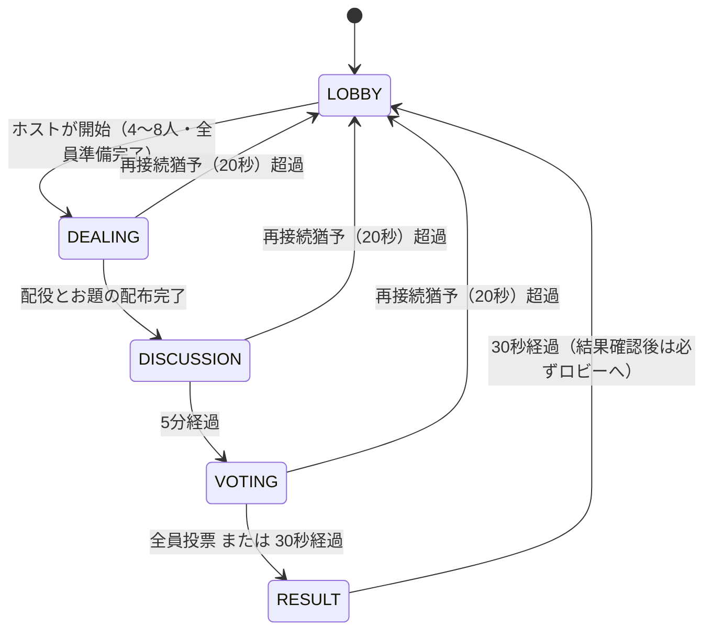
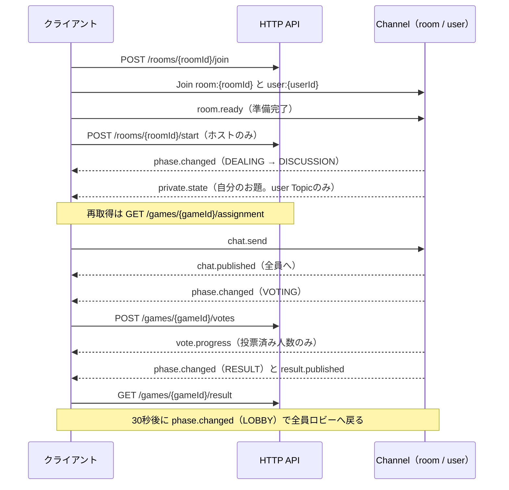
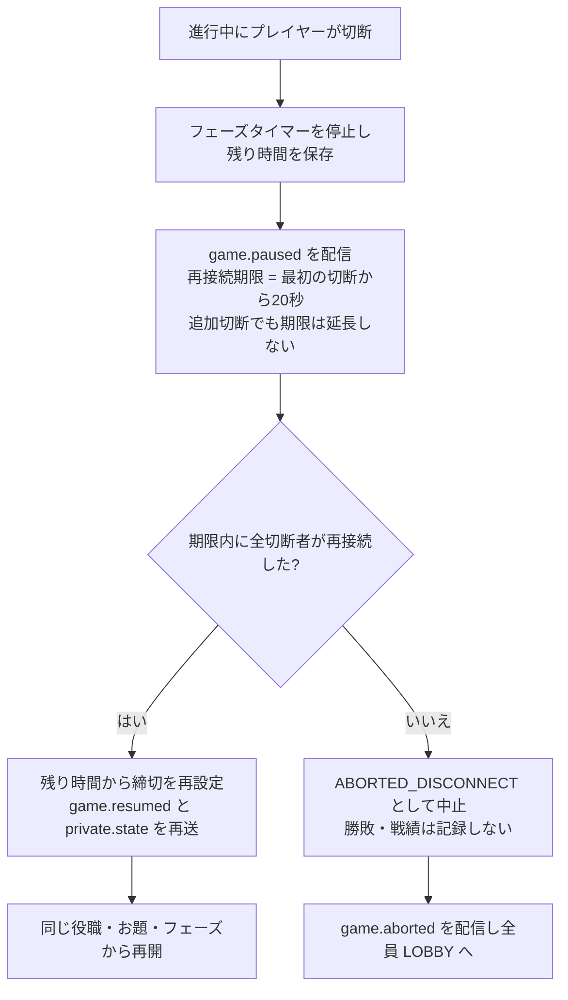
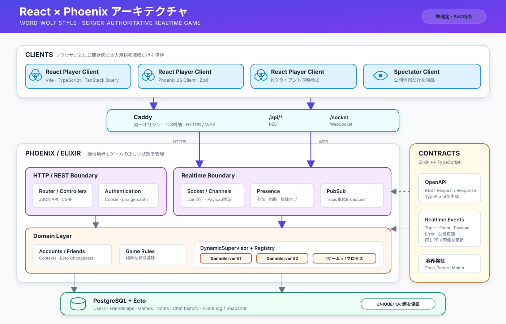
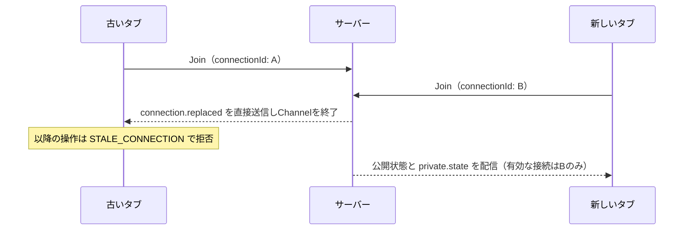

# 図解

> 最終更新: 2026-09-02

現行仕様（[game-spec.md](../spec/game/game-spec.md) / [spec/api/](../spec/api/README.md)）のフロー図。
Mermaidで管理しているため、GitHub上でこのページを開けばそのまま表示され、テキスト差分でレビューできる。

## フェーズ遷移

- 一時停止は独立フェーズにせず、進行フェーズに `paused: true` を付与する。
- 開始直後の3秒カウントダウンはクライアント演出であり、フェーズではない。
- `RESULT → DEALING` の直接遷移（再戦ショートカット）は存在しない。次のゲームは必ずロビーの
  開始フロー（設定確認・準備完了・ホスト開始）を経由する。

## 1ゲームの通信シーケンス（HTTPとChannelの分担）

要求はHTTP、配信はChannelが基本方針。イベントの完全な定義は
[openapi.yaml](../spec/api/openapi.yaml) と [asyncapi.yaml](../spec/api/asyncapi.yaml) を正とする。

## 切断・再接続の例外フロー

## 技術構成図（SVG）

React + Phoenix の全体構成。詳細は [architecture/](../architecture/README.md) を参照。

## 複数タブの接続置換

## 認証と WebSocket のしくみ

REST と WebSocket が同じトークンで本人を決める経路、別タブが別プレイヤーになる理由、Socket / Channel / GameServer の層の重なりを
[auth-socket.md](auth-socket.md) にまとめた（Mermaid 4 枚 + 公式ドキュメントへのリンク）。
