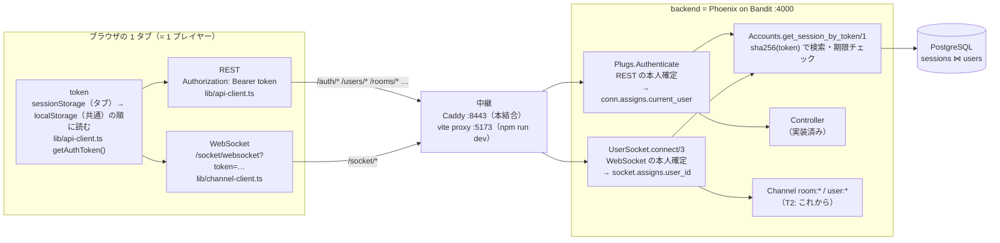
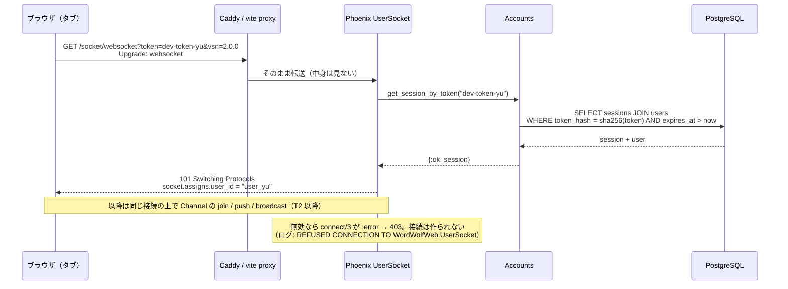
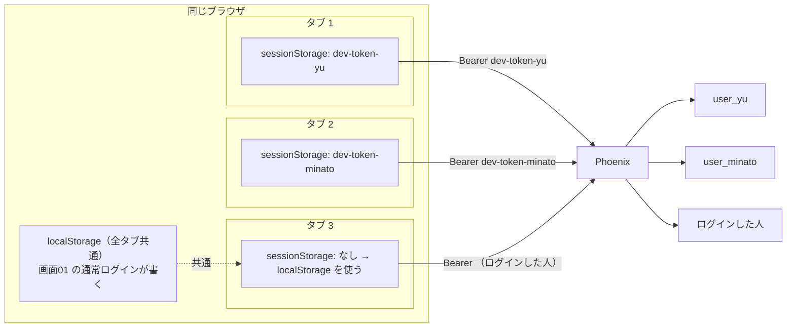
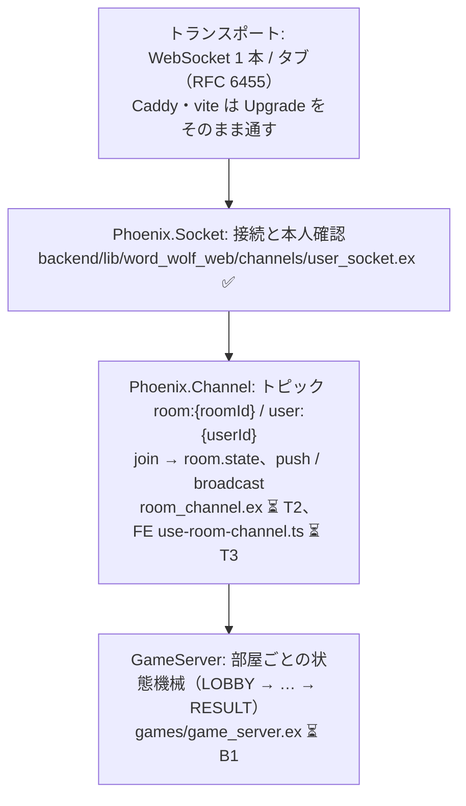
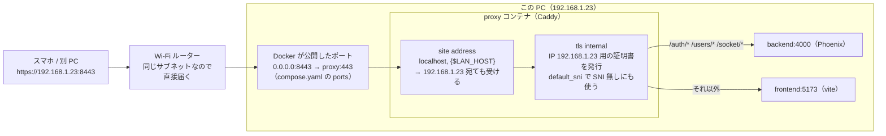

# 認証と WebSocket のしくみ（図解）

> 最終更新: 2026-09-02。GitHub で開くと Mermaid がそのまま描画される。

3 行でまとめると:

1. **本人 = トークン**。サーバーはブラウザもタブも知らない。リクエストに付いたトークンを `sessions` テーブルで照合するだけ
2. **トークンの置き場が「誰になるか」を決める**。`localStorage` はブラウザ全体、`sessionStorage` はタブ単位。だから別タブ = 別プレイヤーにできる
3. **中継（Caddy / vite）は中身を見ない**。REST も WebSocket も同じトークンで、判定するのは Phoenix

## 1. 経路: ブラウザから DB まで

REST と WebSocket で違うのは入口の関数（`Plugs.Authenticate.call/2` か `UserSocket.connect/3`）だけ。どちらも `Accounts.get_session_by_token/1` を呼び、以降のコード（Controller / Channel）は「本人はもう分かっている」前提で書く。

## 2. WebSocket が繋がるまで

REST の場合はこの図の `UserSocket.connect/3` が `Plugs.Authenticate.call/2` に、`101` が `200 + JSON` に、`403` が `401 UNAUTHENTICATED` に置き換わるだけ。

## 3. なぜ別タブが別プレイヤーになるのか

`sessionStorage` はブラウザの標準機能で、タブ（browsing context）ごとに独立している。開発用ページ `/dev/as/<name>` はここに `dev-token-<name>` を書くだけ。自分で登録したプレイヤーは `/dev/as` のフォームで `POST /auth/login` → 返ったトークンを sessionStorage に書く（`useAuth({ scope: 'tab' })`）。本番ビルドにはこのページは含まれない。

## 4. 層の重なり（どこまで出来ていて、次は何か）

いま `/dev/as` の「WebSocket 接続テスト」で見せられるのは L2 まで（本人確認済みの回線が開く）。L3 からがゲームの実装。

## 4.5 同じ Wi-Fi の別端末から繋がるしくみ

`localhost` は「その端末自身」を指すので、スマホから `https://localhost:8443` を開いてもスマホ自身に繋ごうとして失敗する。
代わりに **この PC が Wi-Fi ルーターからもらっている IP**（例 `192.168.1.23`。`make urls` が候補を出す）を使う。

各段で何が起きているか:

| 段 | 何が必要か | どこで設定しているか |
|---|---|---|
| 1. 届く | スマホと PC が同じ Wi-Fi（同じサブネット）にいる。PC の IP を知っている。macOS のファイアウォールで Docker が塞がれていない | `make urls` が `ipconfig getifaddr en0` で IP 候補を表示 |
| 2. Docker に入る | ポート 8443 が `0.0.0.0`（全インターフェース）で公開されている | `compose.yaml` の `proxy.ports: "8443:443"`（既定で全インターフェース） |
| 3. Caddy が受ける | Caddy は **設定に書いた host 宛て**しか応答しない。IP 宛てを受けるには site address に IP が要る。さらに TLS では「その名前の証明書」が要る | `.env` の `LAN_HOST=192.168.1.23` → `compose.yaml` が proxy に渡す → Caddyfile の `localhost, {$LAN_HOST}` と `default_sni {$LAN_HOST}` |
| 4. あとは同じ | パスで backend / frontend に振り分け。FE は同一オリジンで API を呼ぶので、`https://192.168.1.23:8443/users/me` も Caddy が backend へ | `_tools/caddy/Caddyfile`（localhost と同じ経路） |

つまずきやすい点:

- **証明書の警告**。Caddy の `tls internal` は自前の CA で署名するので、スマホは「信頼できない」と言う。HTTP は警告を許可すれば進めるが、**iOS Safari は自己署名だと WebSocket（wss）が失敗する**ことがある。`make ca-cert` で書き出した `_tools/caddy/root.crt` をスマホに入れて信頼させると、警告も wss の失敗も消える
- **`default_sni` が要る理由**。ブラウザは IP 直打ちのとき TLS の SNI（どの名前の証明書が欲しいか）を送らない。Caddy は普通「接続先 IP に一致する証明書」で代替するが、Docker の NAT を通ると Caddy から見た接続先はコンテナの IP（172.x）になり一致しない。そこで「SNI が無ければ LAN_HOST の証明書を使う」と固定している
- **IP が変わる**。Wi-Fi を変えると PC の IP も変わるので、`LAN_HOST` を書き直して `docker compose up -d proxy`
- **PC の localhost からも今までどおり**。site address は `localhost, {$LAN_HOST}` の両方なので、開発者本人の `https://localhost:8443` は影響を受けない

nginx でも考え方は同じで、`server_name` に IP を足し、その IP を SAN に含む証明書を置く、に対応する。

## 5. 対応するファイル

| 役目 | ファイル |
|---|---|
| トークンの読み書き（唯一の場所） | `frontend/src/lib/api-client.ts` |
| REST に Bearer を付ける | 同上（middleware） |
| WebSocket に token を渡す | `frontend/src/lib/channel-client.ts` `createSocket()` |
| タブ単位ログイン（開発） | `frontend/src/pages/dev-login-page.tsx`, `frontend/src/hooks/use-auth.ts`（`scope: 'tab'`） |
| REST の本人確定 | `backend/lib/word_wolf_web/plugs/authenticate.ex` |
| WebSocket の本人確定 | `backend/lib/word_wolf_web/channels/user_socket.ex` |
| 照合の実体 | `backend/lib/word_wolf/accounts.ex` `get_session_by_token/1`, `hash_token/1` |
| 接続の入口 | `backend/lib/word_wolf_web/endpoint.ex` `socket "/socket"` |
| 中継の設定 | `_tools/caddy/Caddyfile`, `frontend/vite.config.ts` |
| 別端末からのアクセス | `.env` の `LAN_HOST`, `compose.yaml`（proxy.environment / ports）, `Makefile`（`urls` / `ca-cert`） |
| 契約 | `_docs/spec/api/openapi.yaml`（REST）, `_docs/spec/api/asyncapi.yaml`（`servers.development` の `token`、channels） |

## 6. 文献

Phoenix / Plug（公式）

- Phoenix.Socket — 接続と `connect/3`, `id/1`: https://hexdocs.pm/phoenix/Phoenix.Socket.html
- Phoenix.Channel — トピック、join / push / broadcast: https://hexdocs.pm/phoenix/Phoenix.Channel.html
- Channels ガイド（全体像と JS クライアント）: https://hexdocs.pm/phoenix/channels.html
- phoenix.js（`new Socket(url, { params })`, `channel()`）: https://hexdocs.pm/phoenix/js/
- Phoenix.Token — 本番で URL に載せる短命トークンの作り方: https://hexdocs.pm/phoenix/Phoenix.Token.html
- mix phx.gen.auth ガイド — セッショントークンをハッシュで保存する考え方: https://hexdocs.pm/phoenix/mix_phx_gen_auth.html
- Plug.Conn — `conn` の中身と `assign/3`, `halt/1`: https://hexdocs.pm/plug/Plug.Conn.html
- Bandit（HTTP / WebSocket サーバー）: https://hexdocs.pm/bandit/

ブラウザ側

- MDN `Window.sessionStorage`（タブ単位の保存領域）: https://developer.mozilla.org/en-US/docs/Web/API/Window/sessionStorage
- MDN `Window.localStorage`: https://developer.mozilla.org/en-US/docs/Web/API/Window/localStorage
- MDN WebSocket API: https://developer.mozilla.org/en-US/docs/Web/API/WebSockets_API
- RFC 6455 — The WebSocket Protocol（`Upgrade: websocket` と 101）: https://www.rfc-editor.org/rfc/rfc6455

中継

- Caddy `reverse_proxy`（WebSocket を透過的に通す）: https://caddyserver.com/docs/caddyfile/directives/reverse_proxy
- Caddy `default_sni`（SNI 無し接続に使う証明書）: https://caddyserver.com/docs/caddyfile/options#default-sni
- Caddy Automatic HTTPS / `tls internal`（ローカル CA）: https://caddyserver.com/docs/automatic-https
- Docker Compose `ports`（ホストの全インターフェースに公開）: https://docs.docker.com/reference/compose-file/services/#ports
- MDN Server Name Indication（SNI）: https://developer.mozilla.org/en-US/docs/Glossary/SNI
- Vite `server.proxy`（`ws: true`）: https://vite.dev/config/server-options#server-proxy

このリポジトリ内

- 縦串の読み方: [../dev/code-walkthrough.md](../dev/code-walkthrough.md)（§4 認証 Plug、§8.5 デモ手順、§10 Phoenix の標準形）
- 次のタスク: [../dev/parallel-tasks.md](../dev/parallel-tasks.md)（T2 / T3 / B1）
