# Mock screenshots

> 最終更新: 2026-08-16

Vite React モックを 390 × 844 px のモバイル表示で撮影した確認用画像です。PCでもアプリ本体は同じモバイル幅で表示されます。
各画面に対応するAPIは [_docs/spec/api/](../../_docs/spec/api/README.md) の対応表を参照してください。

## 認証

| 01 ログイン | 02 新規登録 | 03 アバター設定 |
| --- | --- | --- |
| 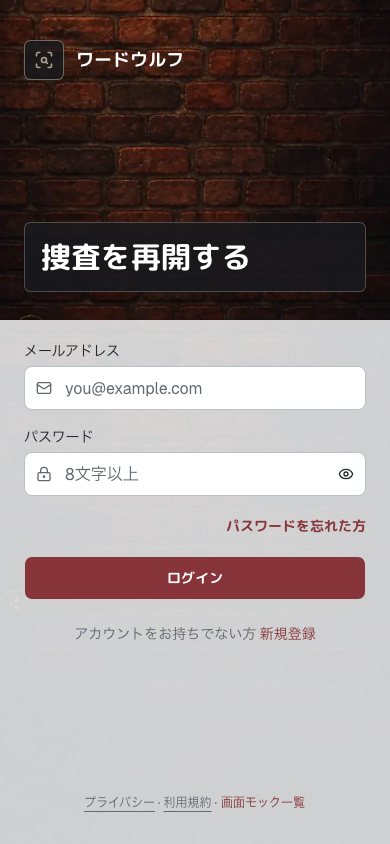 | 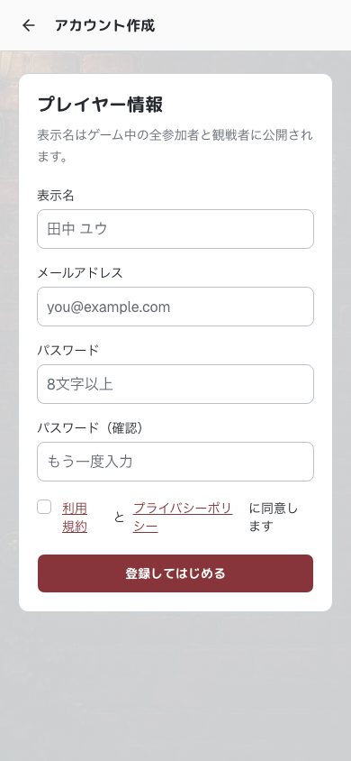 | 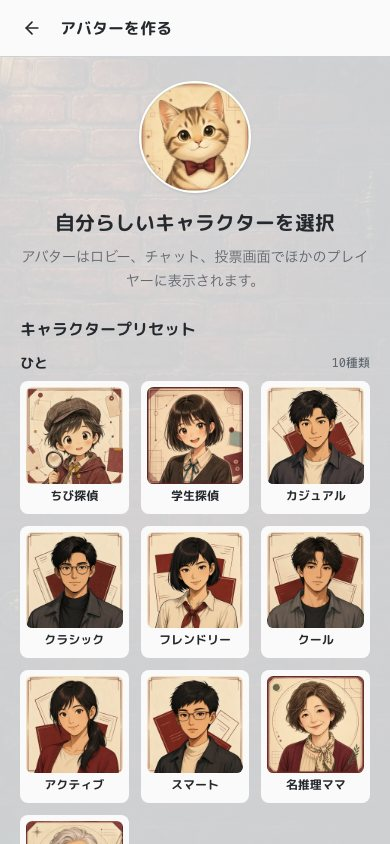 |

## ゲーム開始前

| 04 ホーム | 05 招待URL検索 | 06 招待確認 |
| --- | --- | --- |
| 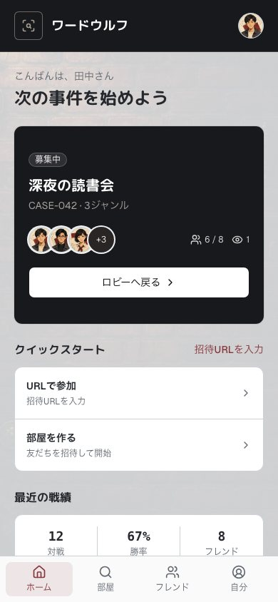 | 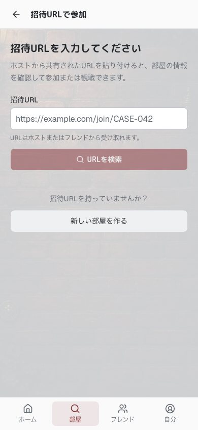 | 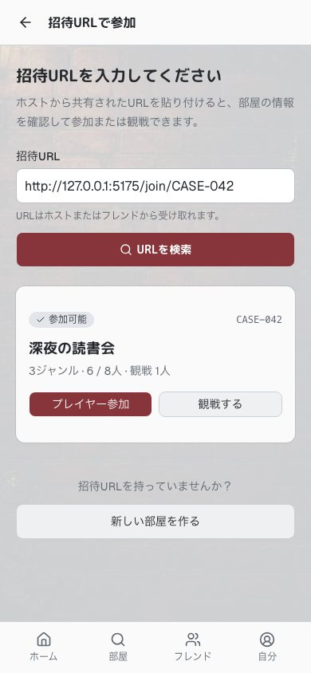 |

| 07 部屋作成 | 08 ロビー（ホスト） | 09 ロビー（参加者） |
| --- | --- | --- |
| 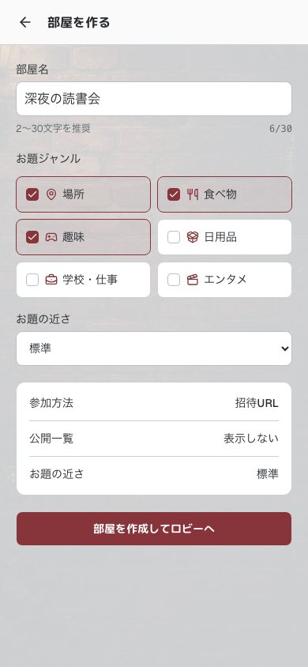 | 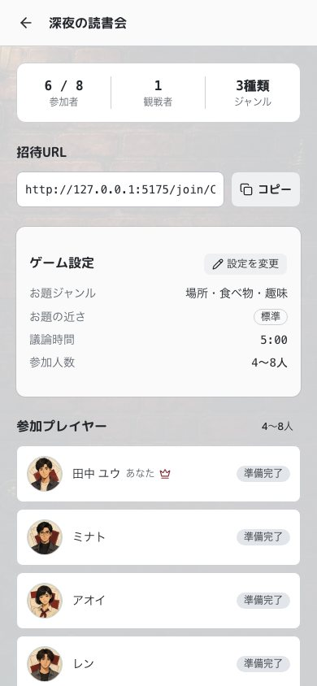 | 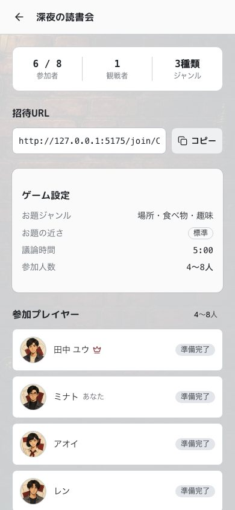 |

| 10 ロビー（観戦者） | | |
| --- | --- | --- |
| 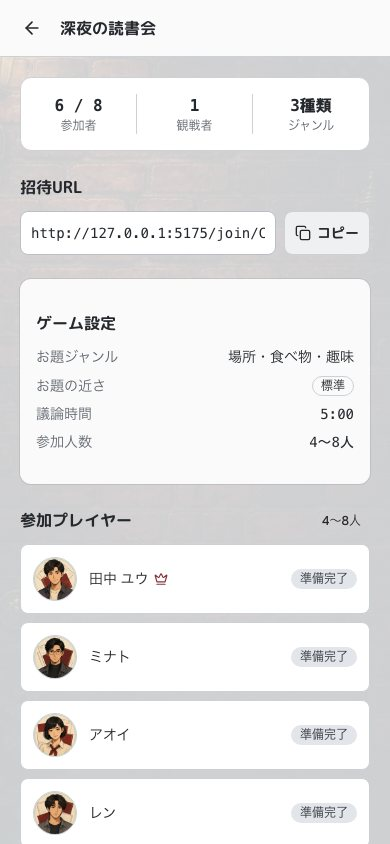 | | |

## ゲーム中

| 11 開始カウントダウン | 12 市民のお題確認 | 13 ウルフのお題確認 |
| --- | --- | --- |
| 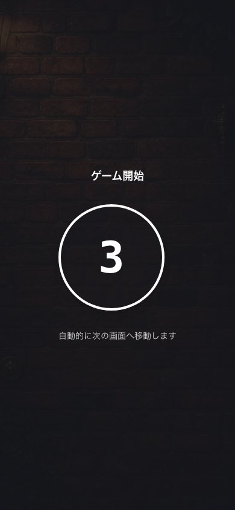 |  | 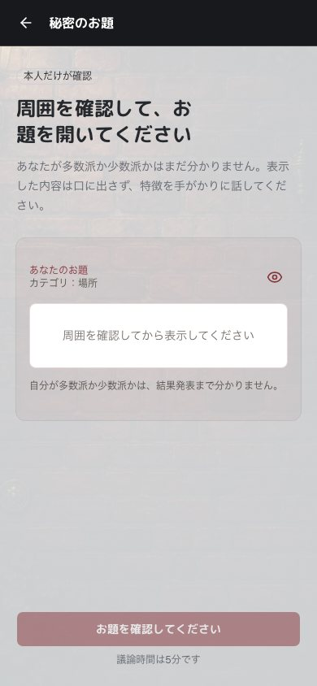 |

| 14 議論（市民） | 15 議論（ウルフ） | 16 観戦画面 |
| --- | --- | --- |
| 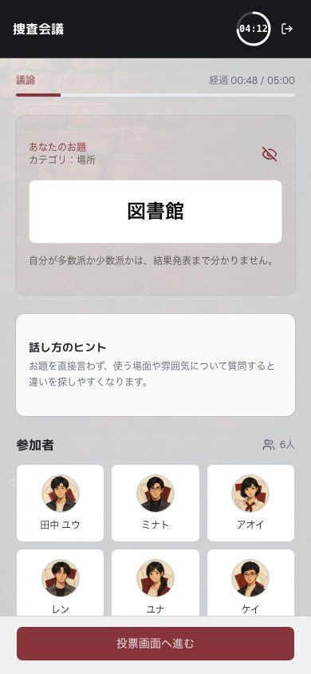 | 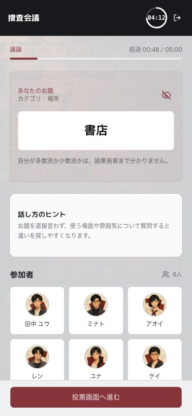 | 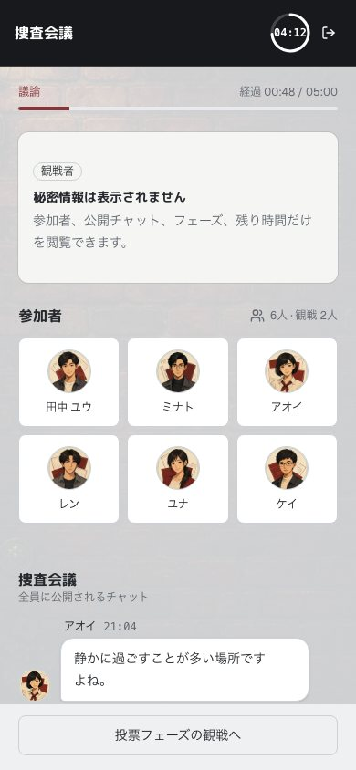 |

| 17 観戦者向け投票 | 18 一時停止 | 19 投票 |
| --- | --- | --- |
| 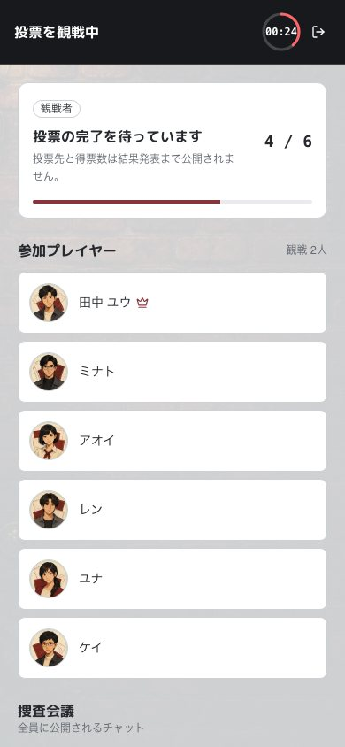 | 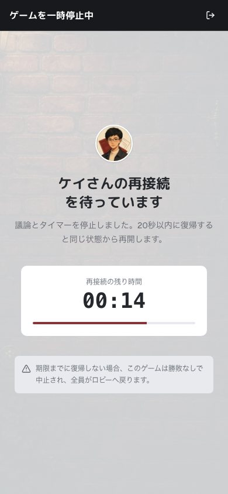 | 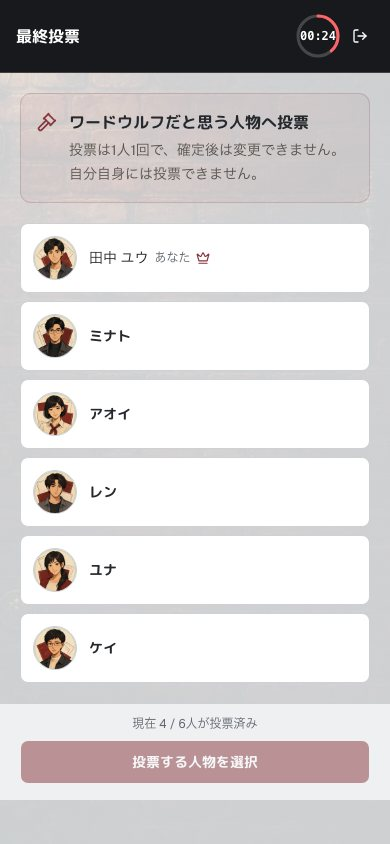 |

| 20 結果発表 | | |
| --- | --- | --- |
| 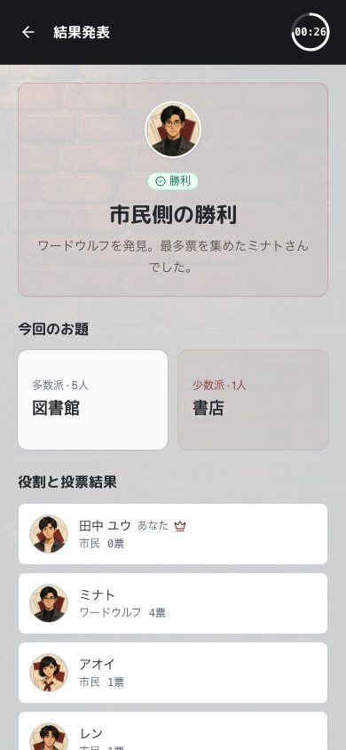 | | |

## ユーザーと必須ページ

| 21 フレンド | 22 プロフィール・設定 | 23 プライバシーポリシー |
| --- | --- | --- |
| 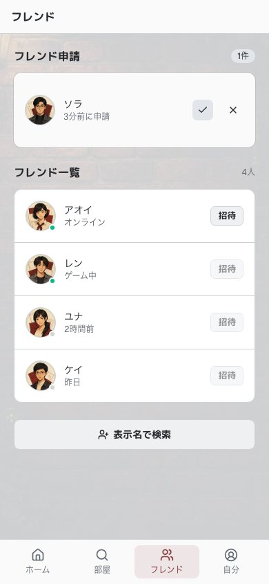 | 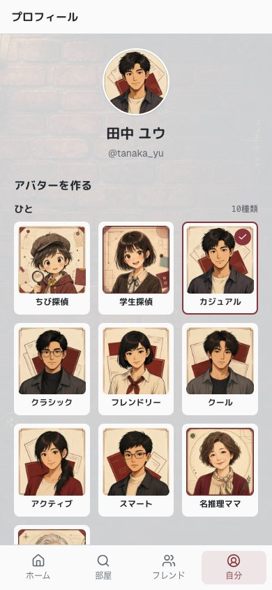 | 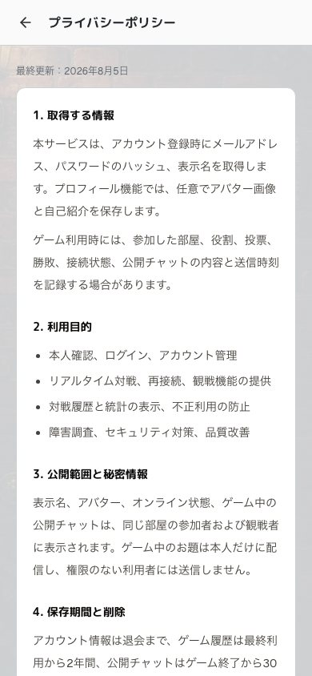 |

| 24 利用規約 | 25 モック一覧 | |
| --- | --- | --- |
| 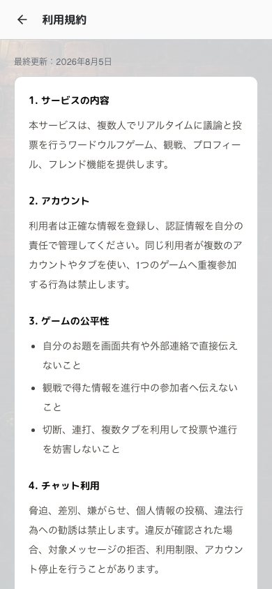 | 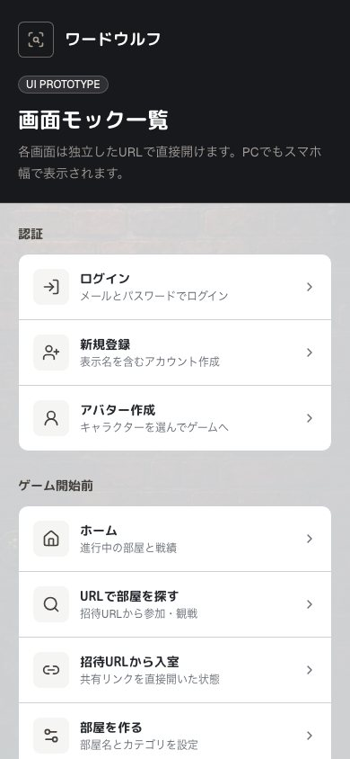 | |

## 再生成

```sh
npm run dev -- --host 127.0.0.1 --port 5175
MOCK_BASE_URL=http://127.0.0.1:5175 npm run screenshots
```

JPEG 品質 84 で保存し、共有時のファイルサイズを抑えています。
